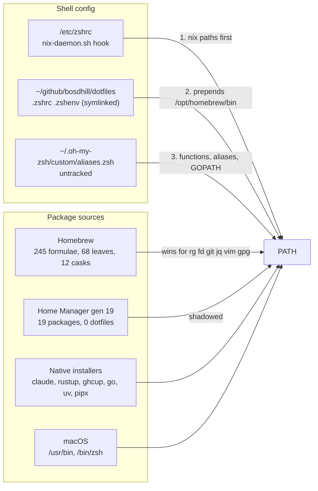
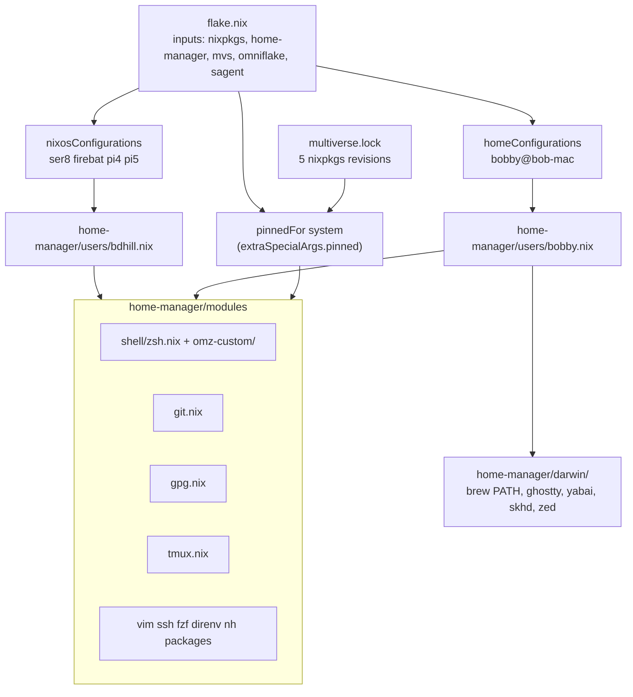
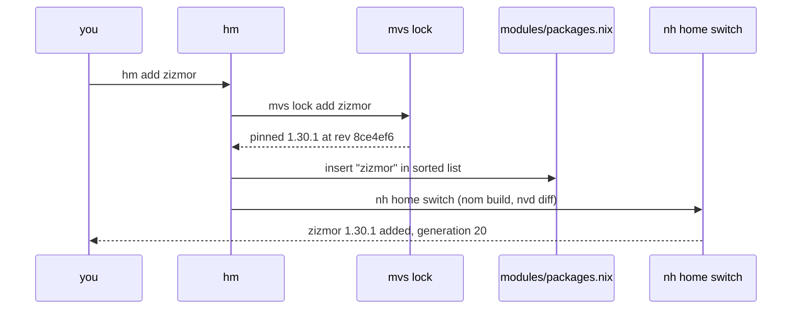
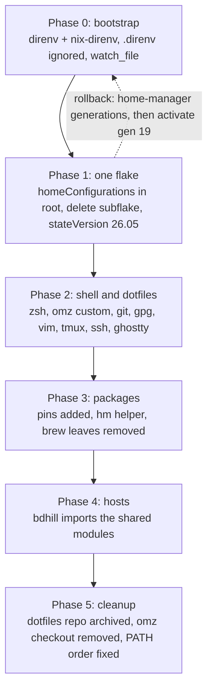

# Home Manager migration plan

Repository: `~/github/catgrep/nixos-config`.
Machine: `bob-mac` (aarch64-darwin, Determinate Nix 3.22.2), user `bobby`.
Shared with: the `bdhill` user on ser8, firebat, pi4 and pi5.
Prepared 2026-09-27 from a survey of the live home directory, Homebrew, oh-my-zsh, the dotfiles repo, and the locked Home Manager 26.05 sources.

## Decisions already taken

- Claude Code stays on its native installer, Codex stays a Homebrew cask.
  Home Manager only puts `~/.local/bin` on PATH.
- `nh` becomes the switch and clean tool, wrapped by a small `hm` helper that also drives `mvs lock`.
- `home.stateVersion` moves to `26.05` for `bobby` before the first real switch, so the new XDG defaults apply from day one.
- `multiverse.lock` was minimized on 2026-09-27 (29 revisions to 5, every version unchanged) and committed as `62e633c`.
- The eval-cache finding is written up in `~/scratch/nixos/nix-develop-does-not-populate-eval-cache.md`.
- The uncommitted `/Users/bobby` read path in `flake.nix` is left alone.

## 1. Where things are today

Four package sources and three config sources compete.
Homebrew is prepended to PATH after the Nix hook runs, so brew shadows every Nix copy of the same tool.



Facts that shape the plan:

| Item | Today |
|---|---|
| Duplicated tools (brew formula and a multiverse pin) | coreutils, curl, fd, ffmpeg, git, gnupg, jq, mosh, openssl, prek, ripgrep, rsync, shellcheck, shfmt, sqlite, vim, wget |
| `.zshrc` | 364 lines, about 40 of real content, an inlined 250-line nfpm completion, four `source <(tool completion zsh)` at every start |
| `.zshenv` | sourced twice, hardcodes a brew llvm@18 Cellar path |
| Shell startup | 0.32s |
| `~/.config/git/ignore` | the same line repeated 49 times |
| Home Manager flake | own `flake.lock`, `stateVersion = "24.11"`, last switch 2026-03-18 |
| Dotfiles repo | 3 commits, dirty since 2025-09 |

## 2. Target architecture

One flake, one lock, one set of Home Manager modules used by both users.
Per-user files stay under ten lines.
Platform differences live inside the module they affect, gated on `pkgs.stdenv.hostPlatform.isDarwin`.



### Proposed tree

```
home-manager/
  default.nix              # imports = [ ./modules ]
  modules/
    default.nix            # imports every file below
    shell/
      zsh.nix              # programs.zsh, oh-my-zsh, dotDir, ZSH_CUSTOM wiring
      omz-custom/
        aliases.zsh        # jpr, gtop, fman, tmosh, capture
        git.zsh            # gsk, gtchk
      completions/         # pre-generated *.zsh files added to fpath
    git.nix                # programs.git: aliases, signing, lfs, osxkeychain on darwin
    gpg.nix                # programs.gpg + services.gpg-agent, pinentry per platform
    tmux.nix               # shared config, copy-command per platform
    vim.nix                # programs.vim with the 4-line vimrc
    ssh.nix                # programs.ssh matchBlocks
    fzf.nix
    direnv.nix             # programs.direnv + nix-direnv
    nh.nix                 # programs.nh + the hm helper
    packages.nix           # cross-platform CLI list from pinned, one attr per line
  darwin/
    default.nix            # sessionPath, brew PATH after nix, darwin-only packages
    ghostty.nix            # programs.ghostty.settings
    files.nix              # xdg.configFile for yabai, skhd, zed
  users/
    bobby.nix              # username, homeDirectory, stateVersion 26.05, imports
    bdhill.nix             # username, homeDirectory, stateVersion 25.05, imports
```

`users/bdhill.nix` at the repo root keeps only `systemConfig`.
The old `home-manager/flake.nix` and `home-manager/flake.lock` are deleted.
The `home-manager.nix` module from mvs is not used; `pinned` keeps coming through `extraSpecialArgs` because overlays are discarded under `useGlobalPkgs`.

### Root flake wiring

```nix
homeConfigurations."bobby@bob-mac" = home-manager.lib.homeManagerConfiguration {
  pkgs = nixpkgs.legacyPackages.aarch64-darwin;
  extraSpecialArgs.pinned = pinnedFor "aarch64-darwin";
  modules = [ ./home-manager/users/bobby.nix ];
};
```

The `user@host` name is what `nh home switch` discovers without a `-c` flag.

### Shared module examples

```nix
# home-manager/modules/shell/zsh.nix
{ config, lib, pkgs, pinned, ... }:
{
  programs.zsh = {
    enable = true;
    package = pinned.zsh;
    dotDir = "${config.xdg.configHome}/zsh";
    history = { size = 50000; save = 50000; ignoreDups = true; ignoreSpace = true; };
    oh-my-zsh = {
      enable = true;
      theme = "fino-time";
      plugins = [ "git" ];
      custom = "${config.xdg.configHome}/oh-my-zsh";
      extraConfig = "ZSH_DISABLE_COMPFIX=true";
    };
    initContent = lib.mkOrder 550 ''
      fpath+=("${config.xdg.configHome}/zsh/completions")
    '';
  };
  home.file."${config.xdg.configHome}/oh-my-zsh" = {
    source = ./omz-custom;
    recursive = true;
  };
  home.file."${config.xdg.configHome}/zsh/completions" = {
    source = ./completions;
    recursive = true;
  };
}
```

```nix
# home-manager/modules/gpg.nix
{ pkgs, pinned, ... }:
let
  darwin = pkgs.stdenv.hostPlatform.isDarwin;
in
{
  programs.gpg = { enable = true; package = pinned.gnupg; };
  services.gpg-agent = {
    enable = true;
    defaultCacheTtl = 34560000;
    maxCacheTtl = 34560000;
    pinentry.package = if darwin then pinned.pinentry_mac else pkgs.pinentry-curses;
  };
}
```

```nix
# home-manager/modules/git.nix (excerpt)
{ lib, pkgs, pinned, ... }:
{
  programs.git = {
    enable = true;
    package = pinned.git;
    lfs.enable = true;
    signing = { key = "05BE930549C3E945BA3D8B6E72B6A6E95F049306"; signByDefault = true; };
    settings = {
      user = { name = "Bobby Dhillon"; email = "bdhillon1994@gmail.com"; };
      pull.rebase = true;
      init.defaultBranch = "main";
      alias = { rb = "rebase"; rbi = "rebase --interactive"; st = "status"; };
      credential.helper = lib.mkIf pkgs.stdenv.hostPlatform.isDarwin "osxkeychain";
    };
    ignores = [ "*~" ".DS_Store" "**/.claude/settings.local.json" ];
  };
}
```

The bdhill host identity (`catgrep`, `catgrep@sudomail.com`, no signing) is an override in `users/bdhill.nix`, not a second git module.

## 3. The `hm` helper

`hm` is a `writeShellApplication` installed by `nh.nix`.
It wraps `mvs lock` and `nh home` so that adding a tool is one command again.



Subcommands:

| Command | Does |
|---|---|
| `hm add <attr>[@version]` | `mvs lock add`, insert the attr in `packages.nix`, switch |
| `hm rm <attr>` | remove from `packages.nix`, `mvs lock rm`, switch |
| `hm up [attr]` | `nix flake update mvs`, `mvs lock update <attr>` or `--all`, switch |
| `hm switch` | `nh home switch` from anywhere |
| `hm status` | `mvs lock status` plus `mvs lock minimize --check` |
| `hm try <attr>` | `nix shell nixpkgs#<attr>`, nothing installed |
| `hm clean` | `nh clean user --keep 5` |

`packages.nix` keeps one attribute per line in alphabetical order so the insert is a plain text edit, checked by `nix eval` before the switch.
`nix fmt` runs after the edit.

```nix
# home-manager/modules/nh.nix (excerpt)
{ config, pkgs, pinned, ... }:
{
  programs.nh = {
    enable = true;
    package = pinned.nh;
    homeFlake = "${config.home.homeDirectory}/github/catgrep/nixos-config";
    clean = { enable = true; extraArgs = "--keep 5"; };
  };
  home.packages = [
    (pkgs.writeShellApplication {
      name = "hm";
      runtimeInputs = [ pinned.nh pinned.git pkgs.nixfmt ];
      text = builtins.readFile ./hm.sh;
    })
  ];
}
```

`mvs` itself comes from the dev shell today; the helper needs it on PATH outside the shell, so `mvs.packages.aarch64-darwin.mvs` joins `home.packages` in `darwin/default.nix`.

## 4. Migration phases



### Phase 0: bootstrap direnv

1. `mvs lock add direnv` and `mvs lock add nix-direnv`, add both through `programs.direnv` in the current `home-manager/default.nix`, switch once with the old flake.
2. Add `.direnv/` to `.gitignore`.
3. Extend `.envrc`:

```bash
use flake
watch_file dev.nix multiverse.lock tools/sagent/flake.nix tools/sagent/flake.lock tools/sagent/outputs.nix
```

4. `direnv allow`, open a new shell, confirm `sb` and `mvs` resolve without `make dev`.

Verify: `time zsh -ilc exit` under 0.5s, entering the repo prints the direnv line and nothing evaluates.

### Phase 1: one flake, new state version

1. Add `homeConfigurations."bobby@bob-mac"` to `flake.nix`, pointing at `home-manager/users/bobby.nix` with `stateVersion = "26.05"`.
2. Move the package list into `home-manager/modules/packages.nix` unchanged.
3. Delete `home-manager/flake.nix`, `home-manager/flake.lock`; update `make home-switch` to `nh home switch .`; update `make update`.
4. `nh home switch` with `-b bak` on the first run so any file Home Manager wants to own is backed up rather than refused.

Verify: `home-manager generations` shows gen 20 with the same packages; `nix flake check` on aarch64-darwin passes with only the known unknown-output warnings.

### Phase 2: shell and dotfiles

1. Remove the `~/.zshrc` and `~/.zshenv` symlinks (they point into the dotfiles repo; the repo stays until Phase 5).
2. Write `shell/zsh.nix` and `omz-custom/` from the 40 real lines of the current config.
   Drop: the nfpm completion, `source ~/.zshenv`, the travis hook, the `bdhill` PATH entries, the anaconda comment, `/usr/local/sbin`.
   Keep: `gsk`, `gtchk`, `tmosh`, `capture`, `jpr`, `gtop`, `fman`, `GPG_TTY`, `EDITOR`, `BUILDX_BAKE_ENTITLEMENTS_FS`, `BINDGEN_EXTRA_CLANG_ARGS`, ghostty and iterm integration guarded by their env vars.
3. Generate completions once into `completions/` (`nfpm completion zsh`, `hugo completion zsh`, `minikube completion zsh`, `docker completion zsh`, `kubectl completion zsh`) instead of sourcing them per shell.
4. `git.nix`, `gpg.nix`, `vim.nix`, `tmux.nix`, `ssh.nix`, `fzf.nix` from the files listed in section 6.
5. `darwin/ghostty.nix` and `darwin/files.nix` for yabai, skhd and zed.
6. Switch, open a new terminal, run `gsk --help`, `git lg`, sign a test commit, confirm `pinentry-mac` prompts.

Verify: `zsh -ilc 'echo $ZDOTDIR'` prints `~/.config/zsh`; startup under 0.25s; `gpg --card-status` or a signed commit works.

### Phase 3: packages and Homebrew

1. For each row in section 5 marked "move": `hm add <attr>` (the helper lands in this phase, so the first few go through `mvs lock add` by hand).
2. `brew uninstall` the moved leaves, then `brew autoremove`, then `brew cleanup`.
3. Reorder PATH in `darwin/default.nix`: Nix profile first, `/opt/homebrew/bin` appended last.
4. Remove the `aeroxy/tap` and any tap that only served a moved formula.

Verify: `command -v rg fd git jq vim gpg` all resolve under `/nix/store` or `~/.nix-profile`; `brew leaves` lists only the "stay" rows.

### Phase 4: hosts share the modules

1. `home-manager/users/bdhill.nix` imports `../modules` and overrides git identity, theme and plugins.
2. `users/bdhill.nix` keeps `systemConfig` only; `flake.nix` imports the new file into `home-manager.users.bdhill`.
3. `make build-ser8`, `make dry-activate-ser8`, `make test-ser8`, then the other hosts.

Verify: `nix eval '.#nixosConfigurations.ser8.config.home-manager.users.bdhill.programs.zsh.dotDir'` prints the XDG path; smoketests pass.

### Phase 5: cleanup

1. Archive `~/github/bosdhill/dotfiles` (tag, push, remove the checkout) once nothing references it.
2. `trash ~/.oh-my-zsh`; Home Manager provides `pkgs.oh-my-zsh`.
3. `trash ~/.zshrc.pre-oh-my-zsh`, `~/.zcompdump*`, the `latest` symlink, `~/Brewfile` (2023).
4. Remove the `home-switch` note from `CLAUDE.md` that describes the subflake and document `hm`.

## 5. Package survey

Every top-level Homebrew formula (`brew leaves`), cask, native installer, and the current Home Manager list, with a decision.
Nixpkgs attribute names and versions come from the multiverse index on 2026-09-27.

### Move to Home Manager (pinned through multiverse.lock)

| Homebrew | nixpkgs attr | Index version | Note |
|---|---|---|---|
| actionlint | actionlint | 1.7.12 | |
| apko | apko | 1.2.37 | |
| ast-grep | ast-grep | 0.45.1 | |
| bats-core | bats | 1.14.0 | |
| cmake | cmake | 4.4.2 | |
| cosign | cosign | 3.1.3 | |
| crane | crane | 0.22.0 | |
| curl | curl | 8.21.0 | already pinned |
| dive | dive | 0.13.1 | |
| docker-compose | docker-compose | 5.5.1 | Docker Desktop CLI plugin dir stays |
| doxygen | doxygen | 1.17.0 | |
| eslint | eslint | 10.10.0 | |
| fd | fd | 10.4.2 | already pinned and in Home Manager |
| ffmpeg (+@6, @7) | ffmpeg | 8.1.2 | already pinned; drop the two old majors |
| flock | flock | 0.4.0 | |
| flyctl | flyctl | 0.4.102 | |
| fzf | fzf | 0.74.4 | via `programs.fzf` |
| gh | gh | 2.100.0 | via `programs.gh` |
| git | git | 2.54.0 | already pinned; via `programs.git` |
| git-lfs | git-lfs | 3.7.1 | `programs.git.lfs.enable` |
| gnupg | gnupg | 2.4.9 | already pinned; `programs.gpg` |
| golangci-lint | golangci-lint | 2.13.2 | |
| grype | grype | 0.119.0 | |
| hugo | hugo | 0.166.0 | completion pre-generated |
| jq | jq | 1.8.2 | already pinned |
| ko | ko | 0.19.1 | |
| macos-trash | darwin.trash | n/a | from the nixpkgs input, not pinnable (nested set) |
| melange | melange | 0.59.2 | |
| minikube | minikube | 1.38.1 | completion pre-generated |
| mosh | mosh | 1.4.0 | already pinned |
| neovim | neovim | 0.12.5 | `neovim-unwrapped` already pinned |
| node@22 | nodejs_22 | 22.23.2 | one Node instead of six |
| openjdk | openjdk | 21.0.12.1 | |
| pandoc | pandoc | 3.7.0.2 | |
| pdfgrep | pdfgrep | 2.2.0 | |
| pinentry-mac | pinentry_mac | 1.1.1.1 | `services.gpg-agent.pinentry.package` |
| pnpm | pnpm | 12.3.4 | |
| prek | prek | 0.5.3 | already pinned |
| pv | pv | 1.11.0 | |
| ripgrep-all | ripgrep-all | 1.0.0-alpha.5 | |
| rsync | rsync | 3.4.4 | already pinned |
| shfmt | shfmt | 3.13.1 | already pinned and in Home Manager |
| sox | sox | 14.4.2 | |
| templ | templ | 0.3.1020 | |
| terragrunt | terragrunt | 1.1.3 | drop the bashcompinit hook |
| testkube | testkube | 2.12.2 | |
| traefik (+@2, @3) | traefik | 3.7.13 | |
| uv | uv | 0.12.11 | `programs.uv` |
| vim | vim | 9.2.0541 | already pinned; `programs.vim` |
| wget | wget | 1.25.0 | already pinned |
| yarn | yarn | 1.22.22 | |
| yt-dlp | yt-dlp | 2026.08.19 | `programs.yt-dlp` |
| zig | zig | 0.16.0 | |
| zizmor | zizmor | 1.30.1 | |
| zsh-completions | zsh-completions | 0.36.0 | added to fpath by `programs.zsh` |
| ast-bro (aeroxy/tap) | sagent flake | 3.0.0 | already provided by the dev shell; remove from brew |

### New in Home Manager (not from Homebrew)

| nixpkgs attr | Index version | Purpose |
|---|---|---|
| nh | 4.4.2 | `nh home switch`, `nh clean` |
| nix-output-monitor | 2.2.0 | build view used by nh |
| nvd | 0.2.4 | generation diff used by nh |
| direnv | 2.37.1 | `programs.direnv` |
| nix-direnv | 3.2.0 | `programs.direnv.nix-direnv.enable` |
| comma | 2.4.2 | run a tool once without installing it |

### Stay in Homebrew

| Formula or cask | Why |
|---|---|
| Casks: anaconda, blackhole-16ch, codex, ghostty, siliconscope, stacktower, syncthing, syncthing-app, vscodium, wezterm, whatsapp, zed | GUI apps; Nix on macOS does not manage `.app` bundles well |
| yabai, skhd, borders (felixkratz tap) | launchd services managed by `brew services`; nixpkgs has them but no Home Manager service module |
| docker | Docker Desktop owns the CLI and socket |
| tailscale (launch agent) | GUI app plus daemon |
| openvino, asitop, fprobe, peon-ping, pkgx, omlx, stacktower | Tap-only or Darwin-only tools with no useful nixpkgs attr |
| bpm-tools, opus-tools | Old versions in nixpkgs (0.3 from 2019, 0.2); not worth a pin |
| libffi, lld, llvm, gcc, python@3.x, node@21..25, openssl@3.x, kubectl@1.30..33, ruby@3.x, protobuf@26..29 | Dependency leftovers; `brew autoremove` after the leaves above are uninstalled |
| gocloc, html2markdown | Not in nixpkgs; keep or replace |

### Native installers (unchanged)

| Tool | Location | Why |
|---|---|---|
| Claude Code | `~/.local/share/claude`, symlink in `~/.local/bin` | self-updating; Home Manager adds the path |
| Codex | Homebrew cask | `brew upgrade` tracks releases faster than nixpkgs |
| rustup toolchains | `~/.cargo`, `~/.rustup` | per-project toolchains |
| ghcup, cabal, stack | `~/.ghcup`, `~/.cabal` | same |
| go tools | `~/go/bin` | `go install` targets |
| uv and pipx tools | `~/.local/share/uv`, `~/.local/pipx` | claude-monitor, par-cc-usage |

### Already in Home Manager, keep

ripgrep, fd, bat, nixfmt, nixd, nil, charasay, gitingest, colmena, colima, openssh, openssl, shellcheck, shfmt, nmap, yq-go, addlicense, jujutsu, just.

## 6. Config files ported

| Today | Becomes |
|---|---|
| `~/.zshrc` (symlink to dotfiles) | `programs.zsh` in `shell/zsh.nix`; file lands at `~/.config/zsh/.zshrc` |
| `~/.zshenv` (symlink to dotfiles) | `home.sessionPath`, `home.sessionVariables`; Home Manager writes a two-line `~/.zshenv` |
| `~/.zprofile` (pipx line) | `home.sessionPath` |
| `~/.profile` (cargo env) | `home.sessionPath` includes `~/.cargo/bin` |
| `~/.oh-my-zsh/custom/aliases.zsh` | `shell/omz-custom/aliases.zsh` and `git.zsh` |
| `~/.gitconfig` | `programs.git.settings`, `signing`, `lfs`, `includes` |
| `~/.gitignore_global`, `~/.config/git/ignore` | `programs.git.ignores` (one copy) |
| `~/.gnupg/gpg-agent.conf` | `services.gpg-agent` |
| `~/.vimrc` | `programs.vim.extraConfig` |
| `~/.ssh/config` (3 hosts) | `programs.ssh.matchBlocks`, `enableDefaultConfig = false` |
| Ghostty config | `programs.ghostty.settings` (package left null, cask stays) |
| `~/.config/yabai/yabairc`, `~/.config/skhd/skhdrc` | `xdg.configFile`, executable |
| `~/.config/zed/settings.json`, `keymap.json` | `xdg.configFile` |
| tmux (none on the Mac today) | `tmux.nix` shared with bdhill, `pbcopy` on darwin |
| `~/.npmrc` prefix, `~/.yarnrc` | `home.file` |

## 7. Performance

| Measurement | Before minimize | After minimize |
|---|---|---|
| nixpkgs trees evaluated for the dev shell | 14 | 8 |
| `nix develop`, eval cache cold | 8.2s | 6.0s |
| `nix develop`, eval cache warm | 0.75s | 0.75s |
| Home Manager activation eval, cold | 10.6s | 5.8s |
| Revisions in `multiverse.lock` | 29 | 5 |

The remaining eight trees are three multiverse revisions, nixpkgs-unstable, one each for ast-bro, treehouse and claude-code-sandbox (preserved upstream locks), and one the mvs CLI fetches for itself.
The cache is warm only if something other than `nix develop` populated it; see the issue file.
With direnv the shell is entered from nix-direnv's cache, so the cold cost is paid once per change to a watched file.

## 8. Risks and rollback

- Home Manager refuses to overwrite files it does not own.
  Remove the `.zshrc` and `.zshenv` symlinks before Phase 2 or pass `-b bak`.
- GPG signing depends on `pinentry-mac` being found by the agent; keep the brew copy until the Nix one prompts once.
- The `ccode` function calls `claude update`; it keeps working because Claude stays native.
- `nh clean` removes old generations; keep at least five until Phase 5 so gen 19 is reachable.
- Rollback is `home-manager generations` and activating the previous generation's `activate` script.
  The old subflake is in git history if the root-flake wiring needs to be reverted.

## 9. Open questions for feedback

1. Host name in `homeConfigurations."bobby@bob-mac"`: `bob-mac` is what `hostname -s` returns today; confirm you want the name tied to it.
2. `packages.nix` as a Nix list edited by the helper, or a plain `packages.txt` read with `builtins.readFile`? The list is proposed.
3. Bump `bdhill` to `stateVersion = "26.05"` as well in Phase 4, or keep `25.05` and set `dotDir` explicitly? Explicit `dotDir` is proposed so both users behave the same either way.
4. Keep yabai and skhd under `brew services`, or move to nixpkgs binaries plus your own launchd agents through `launchd.agents`?
