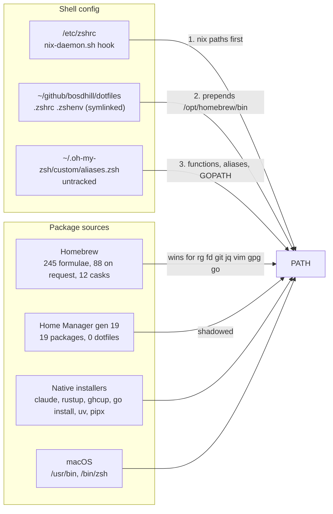
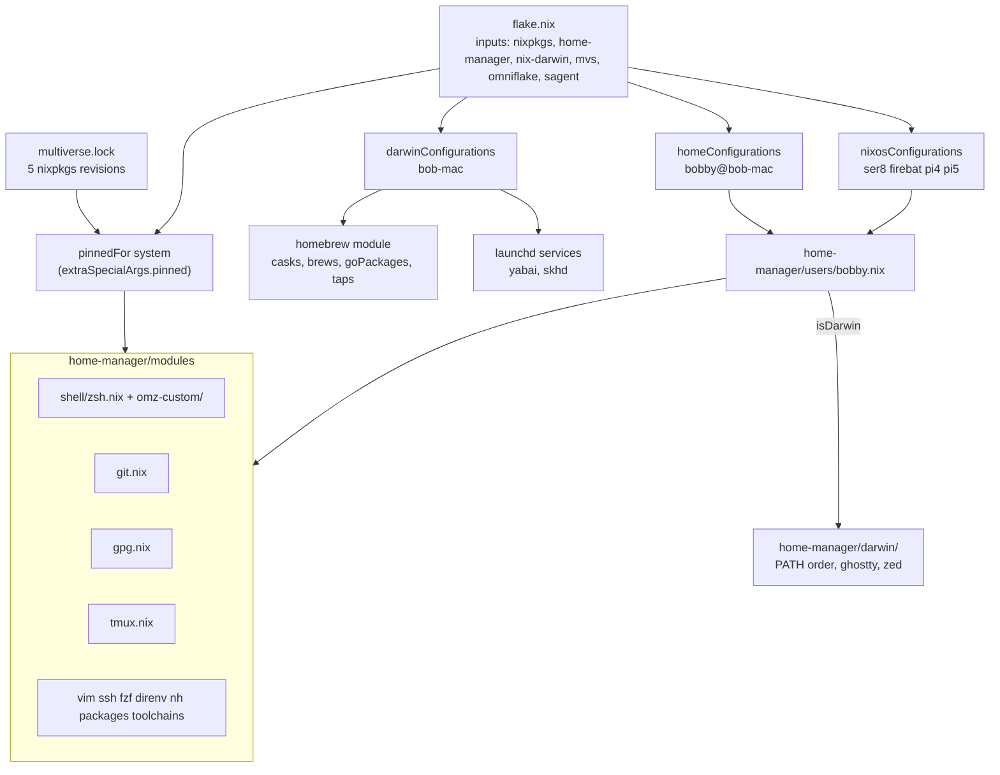
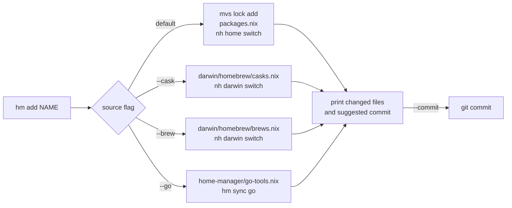
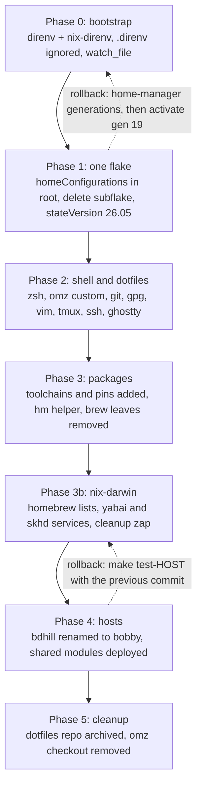

# Home Manager migration plan

Repository: `~/github/catgrep/nixos-config`.
Machine: `bob-mac` (aarch64-darwin, Determinate Nix 3.22.2), user `bobby`.
Shared with: the Linux hosts ser8, firebat, pi4 and pi5, whose account becomes `bobby` as part of this plan.
Prepared 2026-09-27 from a survey of the live home directory, Homebrew, oh-my-zsh, the dotfiles repo, and the locked Home Manager 26.05 sources.
Revised 2026-09-28 after the first review.

## Decisions already taken

- Claude Code stays on its native installer, Codex stays a Homebrew cask.
  Home Manager only puts `~/.local/bin` on PATH.
- One person, one user file: `home-manager/users/bobby.nix` serves the Mac and every Linux host.
  The Linux account is renamed from `bdhill` to `bobby` in Phase 4.
- nix-darwin is adopted for the Mac so Homebrew casks, brew-only formulae, `go install` tools and launchd services are declared in the same flake.
  `nh` drives both layers (`nh home switch`, `nh darwin switch`), wrapped by a small `hm` helper that also drives `mvs lock`.
- Toolchains (Go, Python, Node) come from `multiverse.lock`.
  Tools built with `go install` that nixpkgs lacks are declared in a list `hm` owns and installed by `hm sync` with the pinned Go, not through Homebrew.
- A Codex review of the plan (2026-09-28, `home-manager-migration-review-codex.md`) found two blockers in the account rename and several gaps in the helper; this revision applies all of its findings.
- `home.stateVersion` moves to `26.05` for `bobby` before the first real switch, so the new XDG defaults apply from day one.
- `multiverse.lock` was minimized on 2026-09-27 (29 revisions to 5, every version unchanged) and committed as `62e633c`.
- The eval-cache finding is written up in `~/scratch/nixos/nix-develop-does-not-populate-eval-cache.md`.
- The uncommitted `/Users/bobby` read path in `flake.nix` is left alone.

## 1. Where things are today

Four package sources and three config sources compete.
Homebrew is prepended to PATH after the Nix hook runs, so brew shadows every Nix copy of the same tool.



Facts that shape the plan:

| Item | Today |
|---|---|
| Duplicated tools (brew formula and a multiverse pin) | coreutils, curl, fd, ffmpeg, git, gnupg, jq, mosh, openssl, prek, ripgrep, rsync, shellcheck, shfmt, sqlite, vim, wget |
| Toolchains from brew | go 1.27.0, node 25.6.1, python 3.12 and 3.13, plus rustup and ghcup natively |
| `.zshrc` | 364 lines, about 40 of real content, an inlined 250-line nfpm completion, four `source <(tool completion zsh)` at every start |
| `.zshenv` | sourced twice, hardcodes a brew llvm@18 Cellar path |
| Shell startup | 0.32s |
| `~/.config/git/ignore` | the same line repeated 49 times |
| Home Manager flake | own `flake.lock`, `stateVersion = "24.11"`, last switch 2026-03-18 |
| Dotfiles repo | 3 commits, dirty since 2025-09 |
| `bdhill` on the hosts | `deploy.yaml`, `/etc/nix/machines`, `modules/common/users.nix`, `hosts/ser8/samba.nix`, two provisioning scripts, one validation script, `secrets/ser8.yaml` |

## 2. Target architecture

One flake, one lock, one user file, one set of Home Manager modules.
The Mac adds a nix-darwin system layer for what Nix cannot install on macOS.
Platform differences live inside the module they affect, gated on `pkgs.stdenv.hostPlatform.isDarwin`.



### Is the config the same on the hosts?

Yes.
`bobby.nix` imports the same module list on every machine, and `pinned` resolves from the same `multiverse.lock`, so versions match too.
The only differences are the ones written into the modules: `homeDirectory` (`/Users/bobby` or `/home/bobby`), the clipboard command in tmux, pinentry, the Homebrew PATH entry, and the `darwin/` files that only exist on the Mac.
Host-only overrides, if any are ever needed, go in `hosts/<host>/home.nix` as a second module, not in a second user file.

### Proposed tree

```
home-manager/
  default.nix              # imports = [ ./modules ]
  modules/
    default.nix            # imports every file below
    shell/
      zsh.nix              # programs.zsh, oh-my-zsh, dotDir, ZSH_CUSTOM wiring
      omz-custom/
        aliases.zsh        # jpr, gtop, fman, tmosh, capture
        git.zsh            # gsk, gtchk
      completions/         # pre-generated *.zsh files added to fpath
    git.nix                # programs.git: aliases, signing, lfs, osxkeychain on darwin
    gpg.nix                # programs.gpg + services.gpg-agent, pinentry per platform
    tmux.nix               # shared config, copy-command per platform
    vim.nix                # programs.vim with the 4-line vimrc
    ssh.nix                # programs.ssh matchBlocks
    fzf.nix
    direnv.nix             # programs.direnv + nix-direnv
    nh.nix                 # programs.nh + the hm helper package
    toolchains.nix         # programs.go, python3, nodejs, uv from pinned
    packages.nix           # home.packages = map (n: pinned.${n}) (import ../packages.nix)
  packages.nix             # data: Nix list of pinned attribute names, owned by hm
  go-tools.nix             # data: Nix list of "module@version" strings, owned by hm

tools/
  hm/                      # the helper: a Go module, stdlib only, built with buildGoModule
    default.nix            # buildGoModule with pinned.go_1_27, vendorHash = null
    go.mod                 # module github.com/catgrep/nixos-config/tools/hm, go 1.27
    main.go
    internal/
      nixlist/             # read and write the string-list files hm owns (with golden tests)
      sources/             # inventory: generation, lock, brew lists, go/bin, cargo, uv, native
      run/                 # mvs, nh, git, nix eval as typed calls
    hm_test.go
  sagent/                  # existing
  darwin/
    default.nix            # sessionPath, brew PATH after nix, darwin-only packages
    ghostty.nix            # programs.ghostty.settings
    files.nix              # xdg.configFile for zed
  users/
    bobby.nix              # username, homeDirectory per platform, stateVersion 26.05, imports

darwin/                    # nix-darwin system configuration for bob-mac
  default.nix              # system.stateVersion, nix settings left to Determinate, primaryUser
  homebrew/
    default.nix            # homebrew.enable, taps, onActivation; reads the two lists
    casks.nix              # data: Nix list of cask names, owned by hm
    brews.nix              # data: Nix list of formula names, owned by hm
  services.nix             # services.yabai, services.skhd with the existing rc files
```

`users/bdhill.nix` at the repo root is deleted; its `systemConfig` moves to `modules/common/users.nix` under the name `bobby`, and the `home-manager.users.bdhill` block in `flake.nix` that imports it today is replaced by `home-manager.users.bobby = import ./home-manager/users/bobby.nix`.
The old `home-manager/flake.nix` and `home-manager/flake.lock` are deleted.
`pinned` keeps coming through `extraSpecialArgs` because overlays are discarded under `useGlobalPkgs`.

### Root flake wiring

```nix
homeConfigurations."bobby@bob-mac" = home-manager.lib.homeManagerConfiguration {
  pkgs = nixpkgs.legacyPackages.aarch64-darwin;
  extraSpecialArgs = { pinned = pinnedFor "aarch64-darwin"; inherit mvs; };
  modules = [ ./home-manager/users/bobby.nix ];
};

darwinConfigurations."bob-mac" = nix-darwin.lib.darwinSystem {
  system = "aarch64-darwin";
  specialArgs.pinned = pinnedFor "aarch64-darwin";
  modules = [ ./darwin ];
};
```

The NixOS side passes the same two arguments: `home-manager.extraSpecialArgs = { pinned = config.multiverse.locked; inherit mvs; }` in `baseModules`, so `nh.nix` evaluates identically on every machine.
`nix-darwin` comes from the omniflake index (`github:nix-darwin/nix-darwin` is indexed), following the same policy as disko and sops-nix in `omniflake.nix`.
Home Manager stays standalone on the Mac rather than as a nix-darwin module, so `nh home switch` and `nh darwin switch` remain separate, cheap steps.

### The single user file

```nix
# home-manager/users/bobby.nix
{ pkgs, ... }:
let
  darwin = pkgs.stdenv.hostPlatform.isDarwin;
in
{
  imports = [ ../modules ] ++ (if darwin then [ ../darwin ] else [ ]);
  home.username = "bobby";
  home.homeDirectory = if darwin then "/Users/bobby" else "/home/bobby";
  home.stateVersion = "26.05";
  programs.home-manager.enable = true;
}
```

The git identity is the same person everywhere (`Bobby Dhillon`, the gmail address, signing on), so the `catgrep` identity the hosts use today goes away with the rename.
If you want commits from the servers to stay unsigned, that is a one-line `lib.mkIf (!darwin)` in `git.nix`.

### Shared module examples

```nix
# home-manager/modules/shell/zsh.nix
{ config, lib, pkgs, pinned, ... }:
{
  programs.zsh = {
    enable = true;
    package = pinned.zsh;
    dotDir = "${config.xdg.configHome}/zsh";
    history = { size = 50000; save = 50000; ignoreDups = true; ignoreSpace = true; };
    oh-my-zsh = {
      enable = true;
      theme = "fino-time";
      plugins = [ "git" ];
      custom = "${config.xdg.configHome}/oh-my-zsh";
      extraConfig = "ZSH_DISABLE_COMPFIX=true";
    };
    initContent = lib.mkOrder 550 ''
      fpath+=("${config.xdg.configHome}/zsh/completions")
    '';
  };
  home.file."${config.xdg.configHome}/oh-my-zsh" = {
    source = ./omz-custom;
    recursive = true;
  };
  home.file."${config.xdg.configHome}/zsh/completions" = {
    source = ./completions;
    recursive = true;
  };
}
```

```nix
# home-manager/modules/gpg.nix
{ pkgs, pinned, ... }:
let
  darwin = pkgs.stdenv.hostPlatform.isDarwin;
in
{
  programs.gpg = { enable = true; package = pinned.gnupg; };
  services.gpg-agent = {
    enable = true;
    defaultCacheTtl = 34560000;
    maxCacheTtl = 34560000;
    pinentry.package = if darwin then pinned.pinentry_mac else pkgs.pinentry-curses;
  };
}
```

```nix
# home-manager/modules/toolchains.nix
{ config, pinned, ... }:
{
  programs.go = {
    enable = true;
    package = pinned.go_1_27;
    env.GOPATH = "${config.home.homeDirectory}/go";
    env.GOBIN = "${config.home.homeDirectory}/go/bin";
  };
  home.sessionPath = [ "${config.home.homeDirectory}/go/bin" ];
  programs.uv = { enable = true; package = pinned.uv; };
  home.packages = with pinned; [ python3 nodejs_24 pnpm ];
}
```

## 3. Toolchains and tools that are not in nixpkgs

**The Go toolchain was missed in the first survey**, along with node, coreutils, gnupg, ripgrep, shellcheck, openssl, numpy, tesseract and poppler.
The survey keyed on `brew leaves`, which hides any formula that another formula depends on.
`go` is a dependency of hugo, ko and golangci-lint, so it never appeared.
Section 5 now uses `brew list --installed-on-request`, which lists everything you asked for (88 formulae).

**Toolchains** come from `multiverse.lock`: `go_1_27` (1.27.1 indexed), `python3` (3.14.7), `nodejs_24` (24.20.0), `uv` (0.12.11).
rustup and ghcup stay native; they manage their own toolchain versions and per-project overrides in ways nixpkgs does not replicate.

**Tools you built with `go install`** split two ways.
Most are packaged: gopls, delve, buf, protoc-gen-go, protoc-gen-go-grpc, gotestsum, gotests, hclfmt, go-licenses, goda, nfpm, mani, diffoci, go-arch-lint, and `go-tools` for staticcheck.
Those become pins and `hm add` handles them.
The rest (gomodifytags and impl are years stale in nixpkgs, kubetest2 and its testers, git-codereview, goplay, arch-go, benchstat, isocule) stay as `go install` targets, declared in `home-manager/go-tools.nix` and installed by `hm sync go`:

```nix
# home-manager/go-tools.nix, written by hm, one entry per line, sorted
[
  "github.com/fatih/gomodifytags@v1.17.0"
  "github.com/josharian/impl@v1.4.0"
  "sigs.k8s.io/kubetest2@v0.0.0-20250325"
]
```

`hm sync go` reads each entry, compares it with the module path and version that `debug/buildinfo` reports for the binary already in `~/go/bin`, and runs `go install` with the pinned toolchain only for entries that are missing or differ.
nix-darwin's `homebrew.goPackages` was considered and rejected: `brew bundle` installs Homebrew's own `go` formula to run those entries, appends `@latest` itself so versions cannot be pinned, and does not accept `/...` patterns.
Every one of those conflicts with a pinned toolchain.

**pip and uv tools** follow the same rule.
`claude-monitor` and `par-cc-usage` stay under `uv tool` because they are not in nixpkgs; `programs.uv` provides the toolchain.
Anything that is in nixpkgs (`python3Packages.*` is not pinnable through mvs, so these come from the nixpkgs input) goes through `python3.withPackages` in `toolchains.nix` when a project needs it.
There is no `homebrew.pipPackages`, so a pip tool with no nixpkgs attribute is the one case that stays imperative.

## 4. The `hm` helper

`hm` is a small Go program in `tools/hm/`, next to sagent, with module path `github.com/catgrep/nixos-config/tools/hm` and `go 1.27` in its `go.mod`.
The flake builds it with `buildGoModule` on the pinned `go_1_27` toolchain and installs it through `nh.nix`.
It wraps `mvs lock`, `nh home`, `nh darwin` and the nix-darwin Homebrew lists, so adding anything is one command again.
Go rather than a shell script because every file `hm` edits is a file `hm` must parse back exactly, the inventory needs to read Go build info, and each of those wants a unit test.
The standard library covers all of it (`os/exec`, `debug/buildinfo`, `encoding/json`, `text/template`), so `vendorHash` stays `null` and nothing needs re-vendoring.
The cargo inventory comes from `cargo install --list` rather than parsing `.crates.toml`, since the standard library has no TOML decoder.

### Rules for the shared lock

`multiverse.lock` is shared with the hosts and the dev shell, so `hm` never treats it as its own package list:

- `hm add <attr>` reuses an existing pin when the lock already has one and only calls `mvs lock add` for a new attribute.
  A version given on the command line for an attribute that is already pinned is refused; changing a shared pin is `hm up`.
- `hm rm <name>` removes the name from `packages.nix` only.
  The pin stays in the lock unless `--prune` is given and `hm` has confirmed no other consumer names it (dev.nix, modules, hosts), which it checks with `rg` over the repo before calling `mvs lock rm`.
- `hm up <attr>` is allowed only for attributes present in `packages.nix`; anything else is a host or dev-shell pin and needs `hm up --repo <attr>`, which prints the consumers it will affect first.
  `hm up` with no attribute updates only the `packages.nix` set, never `--all`.
- After `nix flake update mvs`, `hm` runs the refreshed index through `nix run "$NH_FLAKE#mvs" --` rather than the `mvs` already on PATH, which is still the previous generation's build.
  Existing version constraints stay in force, and `hm` reports which pins they held back.
- Both `flake.lock` and `multiverse.lock` are in the printed change set when an update touched them.

```mermaid
sequenceDiagram
  participant U as you
  participant HM as hm
  participant MVS as mvs lock
  participant PK as home-manager/packages.nix
  participant NH as nh home switch
  participant G as git
  U->>HM: hm add zizmor
  HM->>MVS: mvs lock add zizmor
  MVS-->>HM: pinned 1.30.1 at rev 8ce4ef6
  HM->>PK: insert "zizmor" in sorted list
  HM->>NH: nh home switch (nom build, nvd diff)
  NH-->>HM: generation 20
  HM->>G: git status --short multiverse.lock home-manager/
  HM-->>U: added zizmor 1.30.1; uncommitted: multiverse.lock, packages.nix
```



Subcommands:

| Command | Does |
|---|---|
| `hm add <attr>[@version]` | reuse or create the pin, insert the attr in `packages.nix`, `nh home switch` |
| `hm add --cask <name>` | append to `darwin/homebrew/casks.nix`, `nh darwin switch` |
| `hm add --brew <name>` | append to `darwin/homebrew/brews.nix`, `nh darwin switch` |
| `hm add --go <module@version>` | append to `go-tools.nix`, `hm sync go` |
| `hm rm [--prune] <name>` | remove from whichever list holds the name, then the matching switch; `--prune` also drops an unreferenced pin |
| `hm up [attr] [--repo]` | `nix flake update mvs`, `mvs lock update` for the named or the `packages.nix` pins, `nh home switch` |
| `hm sync [go]` | install or reinstall every `go-tools.nix` entry whose binary is missing or at another version |
| `hm switch [home|darwin|all]` | `nh home switch`, `nh darwin switch`, or both, from anywhere |
| `hm list [--source]` | every package in the current Home Manager generation and the imperative sources, with provenance |
| `hm status` | `mvs lock status`, `mvs lock minimize --check`, uncommitted flake files |
| `hm doctor` | walk PATH and report every binary that shadows a Nix one, plus tools present in `~/go/bin`, cargo or uv that no list declares |
| `hm try <attr>` | `nix shell nixpkgs#<attr>`, nothing installed |
| `hm clean` | `nh clean user --keep 5`, refused while the generation 19 root from Phase 1 still exists |

### What `hm list` shows

It reads the Home Manager generation, not the lock, so it shows what is actually installed.
Each row is tagged with where the package came from:

| Source tag | Meaning | Example |
|---|---|---|
| `pinned` | attribute in `multiverse.lock`, installed through `packages.nix` or a `programs.*` module | ripgrep 15.1.0 |
| `nixpkgs` | from the flake's nixpkgs input, not pinnable (nested attribute sets) | darwin.trash |
| `custom` | built in this repo: `packages/`, `tools/hm`, the sagent subflake | hm, ast-bro, treehouse |
| `cask`, `brew` | declared in `darwin/homebrew/casks.nix` or `brews.nix` | ghostty, docker |
| `go` | every binary in `~/go/bin`, with module path and version read from the binary's build info | gomodifytags v1.17.0 |
| `cargo` | entries in `~/.cargo/.crates.toml` | cargo-watch 8.5.3 |
| `uv` | `uv tool list` | claude-monitor |
| `native` | on PATH from `home.sessionPath` but managed elsewhere | claude 2.1.274, rustup |

A generation records store paths, not where a package was declared, so `hm` derives provenance itself: a path is `pinned` if `packages.nix` or a `programs.*` module names its attribute and the lock resolves to that path, `nixpkgs` if the attribute is in a module but absent from the lock, and `custom` for everything else in the generation.
The `go`, `cargo` and `uv` rows are read from the machine, not from the flake, so they show what `go install` and friends actually left behind.
A `go` row that `go-tools.nix` does not declare is marked undeclared, and `hm doctor` lists it; `cargo` and `uv` rows are inventory only.
`hm list --source pinned` and `hm status` together answer "what is pinned but not installed" (host-only pins such as jellyfin) and "what is installed but not pinned".
Custom tools cannot be added with `hm add`; they are a Nix file in `packages/` and show up as `custom` once imported.

### Commits

`hm` does not commit by default.
After every switch it prints the files it changed and a command that runs from any directory, because the flake path comes from `NH_FLAKE` and the commit is scoped to the files `hm` touched rather than to everything in the working tree:

```
hm: switched bobby@bob-mac to generation 20 (zizmor 1.30.1 added)
hm: uncommitted: multiverse.lock home-manager/packages.nix
hm: git -C /Users/bobby/github/catgrep/nixos-config commit -m "home: add zizmor 1.30.1" -- multiverse.lock home-manager/packages.nix
```

The subject is generated from a template, not by a model: layer, verb, name, version.
`home: add zizmor 1.30.1`, `home: update ripgrep 15.1.0 to 15.2.0`, `home: remove charasay`, `darwin: add cask ghostty`, `darwin: add go gomodifytags@latest`.
`hm add --commit` runs that exact command, so the day-to-day path is `hm add --commit zizmor`.
Commits are signed by your normal git config; nothing in `hm` touches signing.

A path-scoped commit records the whole current content of each file, so it would sweep in any edit you had already made to those files.
`hm` therefore refuses to start when a file it is about to own has uncommitted changes, and says which one; every file it writes is written to a temporary file and renamed into place.
If the switch fails after the files were edited, `hm` leaves the edits in place, prints them, and does not commit, so the state is visible in `git status` and reversible with `git checkout -- <files>`.

```nix
# home-manager/modules/nh.nix (excerpt)
{ config, pkgs, pinned, mvs, ... }:
{
  programs.nh = {
    enable = true;
    package = pinned.nh;
    flake = "${config.home.homeDirectory}/github/catgrep/nixos-config";
    clean.enable = false; # turned on in Phase 5, after rollback has been exercised
  };
  home.packages = [
    mvs.packages.${pkgs.stdenv.hostPlatform.system}.mvs
    (pkgs.callPackage ../../tools/hm {
      inherit (pinned) nh git;
      buildGoModule = pkgs.buildGoModule.override { go = pinned.go_1_27; };
    })
  ];
}
```

```nix
# tools/hm/default.nix
{ buildGoModule, makeWrapper, lib, nh, git }:
buildGoModule {
  pname = "hm";
  version = "0.1.0";
  src = ./.;
  vendorHash = null;
  nativeBuildInputs = [ makeWrapper ];
  postInstall = ''
    wrapProgram $out/bin/hm --prefix PATH : ${lib.makeBinPath [ nh git ]}
  '';
}
```

`programs.nh.flake` sets `NH_FLAKE`, which `nh home`, `nh darwin`, `nh os` and `hm` all read, so one setting covers every layer.
The files `hm` edits are Nix list literals of strings that it owns outright:

```nix
# home-manager/packages.nix, written by hm, one name per line, sorted
[
  "actionlint"
  "apko"
  "ripgrep"
]
```

These data files live outside `modules/` so the module directory's "import every file" rule never sees them.
`home-manager/packages.nix` is consumed by `modules/packages.nix` as `home.packages = map (name: pinned.${name}) (import ../packages.nix);`, and `go-tools.nix`, `darwin/homebrew/casks.nix` and `brews.nix` have the same shape.
The grammar `hm` accepts is exactly that: a bracketed list of double-quoted strings, one per line, with `#` comments allowed between entries; anything else is an error naming the line.
`hm` parses and re-emits them with a round-trip test, then runs `nix eval --json` on the file before switching, so a malformed edit stops before `nh` sees it.
The flake also exports the package as `packages.<system>.hm` so `nix run .#hm` works before Home Manager has installed it.

## 5. Package survey

Every Homebrew formula you installed on request (`brew list --installed-on-request`, 88 entries), every cask, native installer, and the current Home Manager list, with a decision.
Nixpkgs attribute names and versions come from the multiverse index on 2026-09-27.

### Move to Home Manager (pinned through multiverse.lock)

| Homebrew | nixpkgs attr | Index version | Note |
|---|---|---|---|
| actionlint | actionlint | 1.7.12 | |
| apko | apko | 1.2.37 | |
| ast-grep | ast-grep | 0.45.1 | |
| bats-core | bats | 1.14.0 | |
| cmake | cmake | 4.4.2 | |
| coreutils | coreutils | 9.11 | already pinned |
| cosign | cosign | 3.1.3 | |
| crane | crane | 0.22.0 | |
| curl | curl | 8.21.0 | already pinned |
| dive | dive | 0.13.1 | |
| docker-compose | docker-compose | 5.5.1 | Docker Desktop CLI plugin dir stays |
| doxygen | doxygen | 1.17.0 | |
| eslint | eslint | 10.10.0 | |
| fd | fd | 10.4.2 | already pinned and in Home Manager |
| ffmpeg (+@6, @7) | ffmpeg | 8.1.2 | already pinned; drop the two old majors |
| flock | flock | 0.4.0 | |
| flyctl | flyctl | 0.4.102 | |
| fzf | fzf | 0.74.4 | via `programs.fzf` |
| gh | gh | 2.100.0 | via `programs.gh` |
| git | git | 2.54.0 | already pinned; via `programs.git` |
| git-lfs | git-lfs | 3.7.1 | `programs.git.lfs.enable` |
| gnupg | gnupg | 2.4.9 | already pinned; `programs.gpg` |
| go | go_1_27 | 1.27.1 | `programs.go`; missed in the first survey |
| golangci-lint | golangci-lint | 2.13.2 | |
| grype | grype | 0.119.0 | |
| hugo | hugo | 0.166.0 | completion pre-generated |
| jq | jq | 1.8.2 | already pinned |
| ko | ko | 0.19.1 | |
| macos-trash | darwin.trash | n/a | from the nixpkgs input, not pinnable (nested set) |
| melange | melange | 0.59.2 | |
| minikube | minikube | 1.38.1 | completion pre-generated |
| mosh | mosh | 1.4.0 | already pinned |
| neovim | neovim | 0.12.5 | `neovim-unwrapped` already pinned |
| node, node@22 | nodejs_24 | 24.20.0 | one Node instead of six |
| numpy | python3Packages.numpy | n/a | `python3.withPackages` when a project needs it |
| openjdk | openjdk | 21.0.12.1 | |
| openssl@3 | openssl | 3.6.3 | already pinned |
| pandoc | pandoc | 3.7.0.2 | |
| pdfgrep | pdfgrep | 2.2.0 | |
| pinentry-mac | pinentry_mac | 1.1.1.1 | `services.gpg-agent.pinentry.package` |
| pnpm | pnpm | 12.3.4 | |
| poppler | poppler-utils | n/a | only if pdftotext is still used |
| prek | prek | 0.5.3 | already pinned |
| pv | pv | 1.11.0 | |
| ripgrep | ripgrep | 15.1.0 | already pinned and in Home Manager |
| ripgrep-all | ripgrep-all | 1.0.0-alpha.5 | |
| rsync | rsync | 3.4.4 | already pinned |
| shellcheck | shellcheck | 0.11.0 | already pinned and in Home Manager |
| shfmt | shfmt | 3.13.1 | already pinned and in Home Manager |
| sox | sox | 14.4.2 | |
| templ | templ | 0.3.1020 | |
| terragrunt | terragrunt | 1.1.3 | drop the bashcompinit hook |
| tesseract | tesseract | n/a | only if still used |
| testkube | testkube | 2.12.2 | |
| traefik (+@2, @3) | traefik | 3.7.13 | |
| uv | uv | 0.12.11 | `programs.uv` |
| vim | vim | 9.2.0541 | already pinned; `programs.vim` |
| wget | wget | 1.25.0 | already pinned |
| yarn | yarn | 1.22.22 | |
| yt-dlp | yt-dlp | 2026.08.19 | `programs.yt-dlp` |
| zig | zig | 0.16.0 | |
| zizmor | zizmor | 1.30.1 | |
| zsh-completions | zsh-completions | 0.36.0 | added to fpath by `programs.zsh` |
| ast-bro (aeroxy/tap) | sagent flake | 3.0.0 | already provided by the dev shell; remove from brew |

### `go install` tools that become pins

gopls 0.23.0, delve 1.27.2, buf 1.72.0, protoc-gen-go 1.36.12, protoc-gen-go-grpc 1.6.2, gotestsum 1.13.0, gotests 1.9.0, hclfmt 2.25.0, go-licenses 2.0.1, goda 0.9.4, nfpm 2.47.0, mani 0.32.1, diffoci 0.1.8, go-arch-lint 1.19.0, go-tools 2026.2.1 (staticcheck).

### New in Home Manager (not from Homebrew)

| nixpkgs attr | Index version | Purpose |
|---|---|---|
| nh | 4.4.2 | `nh home switch`, `nh darwin switch`, `nh clean` |
| nix-output-monitor | 2.2.0 | build view used by nh |
| nvd | 0.2.4 | generation diff used by nh |
| direnv | 2.37.1 | `programs.direnv` |
| nix-direnv | 3.2.0 | `programs.direnv.nix-direnv.enable` |
| comma | 2.4.2 | run a tool once without installing it |

### Declared through nix-darwin's Homebrew module

| Entry | List | Why not Nix |
|---|---|---|
| anaconda, blackhole-16ch, codex, ghostty, siliconscope, stacktower, syncthing, syncthing-app, vscodium, wezterm, whatsapp, zed | `homebrew.casks` | GUI apps; Nix on macOS does not manage `.app` bundles well |
| docker | `homebrew.brews` | Docker Desktop owns the CLI and socket |
| openvino, asitop, fprobe, peon-ping, pkgx, omlx, bpm-tools, opus-tools, gocloc, html2markdown | `homebrew.brews` | tap-only, Darwin-only, or stale in nixpkgs |
| gomodifytags, impl, kubetest2 and testers, git-codereview, goplay, arch-go, benchstat, isocule | `home-manager/go-tools.nix` via `hm sync go` (not Homebrew) | not in nixpkgs or years stale there |
| felixkratz/formulae, homeport/tap, jundot/omlx, peonping/tap, stacktower-io/tap | `homebrew.taps` | needed by the rows above |

yabai and skhd move to nixpkgs binaries under nix-darwin's `services.yabai` and `services.skhd`, which own the launchd agents and read your existing rc files.
The `tailscale` launch agent goes with the Tailscale app.
`homebrew.onActivation.cleanup = "zap"` removes anything not in the lists, which is how the 150 dependency leftovers (llvm, gcc, six Node majors, five OpenSSL versions, four kubectl versions) disappear.

### Native installers (unchanged)

| Tool | Location | Why |
|---|---|---|
| Claude Code | `~/.local/share/claude`, symlink in `~/.local/bin` | self-updating; Home Manager adds the path |
| Codex | Homebrew cask, declared in `homebrew.casks` | `brew upgrade` tracks releases faster than nixpkgs |
| rustup toolchains | `~/.cargo`, `~/.rustup` | per-project toolchains; `cargo install` tools are inventoried by `hm list`, not declared |
| ghcup, cabal, stack | `~/.ghcup`, `~/.cabal` | same |
| uv tools | `~/.local/share/uv` | claude-monitor, par-cc-usage; not in nixpkgs |

### Already in Home Manager, keep

ripgrep, fd, bat, nixfmt, nixd, nil, charasay, gitingest, colmena, colima, openssh, openssl, shellcheck, shfmt, nmap, yq-go, addlicense, jujutsu, just.

## 6. Config files ported

| Today | Becomes |
|---|---|
| `~/.zshrc` (symlink to dotfiles) | `programs.zsh` in `shell/zsh.nix`; file lands at `~/.config/zsh/.zshrc` |
| `~/.zshenv` (symlink to dotfiles) | `home.sessionPath`, `home.sessionVariables`; Home Manager writes a two-line `~/.zshenv` |
| `~/.zprofile` (pipx line) | `home.sessionPath` |
| `~/.profile` (cargo env) | `home.sessionPath` includes `~/.cargo/bin` |
| `~/.oh-my-zsh/custom/aliases.zsh` | `shell/omz-custom/aliases.zsh` and `git.zsh` |
| `~/.gitconfig` | `programs.git.settings`, `signing`, `lfs`, `includes` |
| `~/.gitignore_global`, `~/.config/git/ignore` | `programs.git.ignores` (one copy) |
| `~/.gnupg/gpg-agent.conf` | `services.gpg-agent` |
| `~/.vimrc` | `programs.vim.extraConfig` |
| `~/.ssh/config` (3 hosts) | `programs.ssh.matchBlocks`, `enableDefaultConfig = false` |
| Ghostty config | `programs.ghostty.settings` (package left null, cask stays) |
| `~/.config/yabai/yabairc`, `~/.config/skhd/skhdrc` | `services.yabai.extraConfig`, `services.skhd.skhdConfig` in nix-darwin |
| `~/.config/zed/settings.json`, `keymap.json` | `xdg.configFile` |
| tmux (none on the Mac today) | `tmux.nix` shared with the hosts, `pbcopy` on darwin |
| `~/.npmrc` prefix, `~/.yarnrc` | `home.file` |
| `~/Brewfile` (2023) | `darwin/homebrew/` |

## 7. Migration phases



### Phase 0: bootstrap direnv

1. `mvs lock add direnv`, `mvs lock add nix-direnv`, `mvs lock add nh`, `mvs lock add nix-output-monitor`, `mvs lock add nvd`; add direnv through `programs.direnv` and the other three to `home.packages` in the current `home-manager/default.nix`; switch once with the old flake.
   This is the bootstrap: Phase 1 runs `nh` from this generation.
2. Add `.direnv/` to `.gitignore`.
3. Extend `.envrc`:

```bash
use flake
watch_file dev.nix multiverse.lock tools/sagent/flake.nix tools/sagent/flake.lock tools/sagent/outputs.nix
```

4. `direnv allow`, open a new shell, confirm `sb` and `mvs` resolve without `make dev`.

Verify: `time zsh -ilc exit` under 0.5s, entering the repo prints the direnv line and nothing evaluates.

### Phase 1: one flake, new state version

1. Keep generation 19 reachable for the whole migration: `nix build --out-link ~/.local/state/home-manager/keep-gen19 /nix/store/pa2s5qbgbncw97vky87nznmqgxqf3ik7-home-manager-generation` registers a GC root that `nh clean` cannot collect.
2. Add `homeConfigurations."bobby@bob-mac"` to `flake.nix`, pointing at `home-manager/users/bobby.nix` with `stateVersion = "26.05"`.
3. Move the package list into `home-manager/packages.nix` unchanged.
4. Delete `home-manager/flake.nix`, `home-manager/flake.lock`; update `make home-switch` to `nh home switch .`; update `make update`.
5. `nix build '.#homeConfigurations."bobby@bob-mac".activationPackage'` first, because `nix flake check` does not evaluate that output.
6. `nh home switch -- -b bak` on the first run so any file Home Manager wants to own is backed up rather than refused.

Verify: `home-manager generations` shows gen 20 with the same packages; the activation package builds; `nix flake check` on aarch64-darwin passes with only the known unknown-output warnings; `~/.local/state/home-manager/keep-gen19` resolves.

### Phase 2: shell and dotfiles

1. Remove the `~/.zshrc` and `~/.zshenv` symlinks (they point into the dotfiles repo; the repo stays until Phase 5).
2. Write `shell/zsh.nix` and `omz-custom/` from the 40 real lines of the current config.
   Drop: the nfpm completion, `source ~/.zshenv`, the travis hook, the `bdhill` PATH entries, the anaconda comment, `/usr/local/sbin`.
   Keep: `gsk`, `gtchk`, `tmosh`, `capture`, `jpr`, `gtop`, `fman`, `GPG_TTY`, `EDITOR`, `BUILDX_BAKE_ENTITLEMENTS_FS`, `BINDGEN_EXTRA_CLANG_ARGS`, ghostty and iterm integration guarded by their env vars.
3. Generate completions once into `completions/` (`nfpm completion zsh`, `hugo completion zsh`, `minikube completion zsh`, `docker completion zsh`, `kubectl completion zsh`) instead of sourcing them per shell.
4. `git.nix`, `gpg.nix`, `vim.nix`, `tmux.nix`, `ssh.nix`, `fzf.nix` from the files listed in section 6.
5. `darwin/ghostty.nix` and `darwin/files.nix` for zed.
6. Switch, open a new terminal, run `gsk --help`, `git lg`, sign a test commit, confirm `pinentry-mac` prompts.

Verify: `zsh -ilc 'echo $ZDOTDIR'` prints `~/.config/zsh`; startup under 0.25s; a signed commit works.

### Phase 3: packages and the helper

1. `toolchains.nix` with `go_1_27`, `python3`, `nodejs_24`, `uv`; switch; confirm `go version` and `node --version` resolve under the Nix store.
2. `nh.nix` with `programs.nh`, `mvs` on PATH, and the first version of `hm` (add, rm, up, switch, list, status, doctor, try, clean) with `go test ./...` passing and wired into `checks`.
3. For each plain CLI row in section 5 marked "move": `hm add --commit <attr>`.
   Four kinds of row do not go through `hm add` and are handled by hand in this step: attributes a `programs.*` module installs (git, gh, fzf, vim, gpg, uv, yt-dlp, go), Darwin-only attributes that need an `isDarwin` guard (`pinentry_mac`), nested attributes the lock cannot hold (`darwin.trash`, from the nixpkgs input), and ast-bro, which the sagent subflake exports and which `darwin/default.nix` adds to `home.packages` from `sagent.packages`.
4. `hm add --go` for each `go install` tool in section 5, then `hm sync go`.
5. Reorder PATH in `darwin/default.nix`: Nix profile first, `/opt/homebrew/bin` appended last.

Verify: `command -v rg fd git jq vim gpg go node` all resolve under `/nix/store` or `~/.nix-profile`; `hm list` shows every row with the right source tag; `hm doctor` reports nothing undeclared in `~/go/bin`.

### Phase 3b: nix-darwin

1. Add `nix-darwin` to `omniflake.nix`, `darwinConfigurations."bob-mac"` to `flake.nix`, and the `darwin/` directory with `homebrew.nix` written from the "declared through nix-darwin" table and `services.nix` for yabai and skhd.
   Leave `nix.*` settings to Determinate (`nix.enable = false`) so nix-darwin does not fight the installer over `/etc/nix/nix.conf`.
2. `brew services stop yabai skhd`, then `nh darwin switch`; nix-darwin's launchd agents take over.
3. Keep `homebrew.onActivation.cleanup = "none"` for the first activations.
   `brew bundle check` only confirms that declared entries are installed; it says nothing about what cleanup would remove.
   Run `brew bundle cleanup --file=<generated Brewfile>` without `--force`, which prints every formula, cask and tap it would uninstall, and compare that list with `brew list --installed-on-request` and `brew list --cask`.
   Only when that preview contains nothing you want to keep, set `cleanup = "zap"` and switch once more.
4. Extend `hm` with `--cask`, `--brew` and `switch darwin`.

Verify: the cleanup preview is empty after the final switch; `launchctl list | grep -E 'yabai|skhd'` shows the nix-darwin agents; `hm add --cask --commit <name>` round-trips.

### Phase 4: hosts share the config and the account is renamed

The rename is the one live-host mutation in this plan and needs your go-ahead per host.
Two constraints shape the order.
NixOS rejects two accounts with the same uid, so `bdhill` and `bobby` cannot coexist at uid 1000; the rename is one configuration change that removes one and adds the other.
And `createHome` runs during activation, so an empty `/home/bobby` appears the moment the new configuration activates; the home directory must already be in place before that, or the later `mv` lands inside it.
pi5 deploys as the `nixos` user today, not `bdhill`, so it only needs the config change.

Preparation, once, in the repo:

1. `modules/common/users.nix`: rename the account to `bobby`, same `uid = 1000`, groups and SSH key; `home-manager.users.bobby` imports `home-manager/users/bobby.nix`; `users/bdhill.nix` is deleted.
2. `hosts/ser8/samba.nix`: `valid users`, the smbpasswd block, and the secret renamed to `samba_bobby_password` in `secrets/ser8.yaml` with `make sops-edit-ser8`; the two provisioning scripts and the validation script.
3. Do not touch `deploy.yaml` or `etc/nix/machines` yet; every deploy in this phase still connects as `bdhill`.
4. `make build-HOST` for all four hosts.

Per host, in one SSH session that stays open throughout:

5. `ssh bdhill@HOST`, then `sudo -i`.
   The session survives the account's removal because the process already exists; a second terminal with a root shell is the fallback.
6. Snapshot or back up the home storage: on ser8 `zfs snapshot rpool/safe/home@pre-rename`; on firebat (ext4 home) `tar` it into `/persist`; on the Pis a tarball is enough.
7. Stop the user's processes (`loginctl terminate-user bdhill` from the root shell) and `mv /home/bdhill /home/bobby`.
   uid 1000 does not change, so ownership needs no fixing.
8. From the Mac, with `NIXBUILD_USER=bdhill` still in effect, `make test-HOST`.
   Activation finds `/home/bobby` present, drops `bdhill`, and Home Manager activates for `bobby`.
9. From a new terminal on the Mac: `ssh bobby@HOST sudo true`.
   If that fails, activate the previous generation from the still-open root shell (`/nix/var/nix/profiles/system-<n>-link/bin/switch-to-configuration test`), move the directory back, and stop.
10. Only after the new login works: `make switch-HOST`, then on ser8 `smbpasswd -a bobby` from the sops-provided password, then close the old session.

After all four hosts:

11. Update `deploy.yaml` (`targetUser`) and `etc/nix/machines`, run `make update-nix-conf`, and confirm a remote build from the Mac with `nix build --builders @/etc/nix/machines` on an x86_64-linux derivation.
12. Restore the snapshot on any host that needs a second attempt; otherwise delete it after a week.

Verify per host: `ssh bobby@HOST`, `make smoketests-HOST`, `nix eval '.#nixosConfigurations.HOST.config.home-manager.users.bobby.programs.zsh.dotDir'` prints the XDG path, Samba login as `bobby` on ser8, and a reboot brings the host back with `/home/bobby` mounted.
The Pi smoketests in `deploy.yaml` are placeholders today (`test`); add a login, sudo and builder check before this phase so the verification means something.

### Phase 5: cleanup

1. Archive `~/github/bosdhill/dotfiles` (tag, push, remove the checkout) once nothing references it.
2. `trash ~/.oh-my-zsh`; Home Manager provides `pkgs.oh-my-zsh`.
3. `trash ~/.zshrc.pre-oh-my-zsh`, `~/.zcompdump*`, the `latest` symlink, `~/Brewfile` (2023).
4. Update `CLAUDE.md`: remove the subflake and `bdhill` notes, document `hm` and `nh`.
5. Exercise a rollback once (activate generation 19 from its GC root, then switch forward again); then remove `keep-gen19`, set `programs.nh.clean.enable = true` with `--keep 5`, and switch.

## 8. Performance

| Measurement | Before minimize | After minimize |
|---|---|---|
| nixpkgs trees evaluated for the dev shell | 14 | 8 |
| `nix develop`, eval cache cold | 8.2s | 6.0s |
| `nix develop`, eval cache warm | 0.75s | 0.75s |
| Home Manager activation eval, cold | 10.6s | 5.8s |
| Revisions in `multiverse.lock` | 29 | 5 |

The remaining eight trees are three multiverse revisions, nixpkgs-unstable, one each for ast-bro, treehouse and claude-code-sandbox (preserved upstream locks), and one the mvs CLI fetches for itself.
The cache is warm only if something other than `nix develop` populated it; see the issue file.
With direnv the shell is entered from nix-direnv's cache, so the cold cost is paid once per change to a watched file.
`hm add` will drift the lock apart again over time; `hm status` reports the `minimize --check` result so you can run `mvs lock minimize` deliberately.

## 9. Risks and rollback

- Home Manager refuses to overwrite files it does not own.
  Remove the `.zshrc` and `.zshenv` symlinks before Phase 2 or pass `-b bak`.
- GPG signing depends on `pinentry-mac` being found by the agent; keep the brew copy until the Nix one prompts once.
- The `ccode` function calls `claude update`; it keeps working because Claude stays native.
- Generation 19 is protected by an explicit GC root from Phase 1, and `nh clean` stays disabled until Phase 5; keeping five generations would not have been enough across the dozens of switches in Phase 3.
- nix-darwin's `cleanup = "zap"` uninstalls anything not declared and deletes cask data; only the dry-run `brew bundle cleanup` preview shows what that would be, and it must be empty before zap is enabled.
- The account rename touches Samba, SSH, remote builders and the persisted home dataset; do one host at a time, keep a root session open, and move the home directory before activation.
- State version 26.05 turns on `targets.darwin.copyApps`, which copies `.app` bundles into `~/Applications/Home Manager Apps` and checks App Management permission for the terminal; expect a one-time macOS prompt.
  It does not move `~/.gnupg` under XDG; `programs.gpg.homedir` stays at the default.
- Rollback for Home Manager is `home-manager generations` and activating the previous generation's `activate` script; for nix-darwin it is `darwin-rebuild --rollback`; for hosts it is `make test-HOST` on the previous commit.

## 10. Open questions for feedback

1. `programs.go` env: keep `GOPATH=~/go` and `GOBIN=~/go/bin` as today, or move to XDG (`~/.local/share/go`)? Today's layout is proposed so `hm sync go` and the existing binaries line up.
2. Git identity on the hosts: same signed identity everywhere (proposed), or unsigned commits on the servers?
3. `homebrew.onActivation.cleanup`: `"zap"` after the dry-run preview is empty (proposed), or `"uninstall"` which leaves cask data behind?
4. Rename cutover: one host per day with the open-session procedure (proposed), or all four in one session?
5. `cargo install` tools: inventory only (proposed), or a `cargo-tools.nix` list with `hm sync cargo` on the same model as Go?
