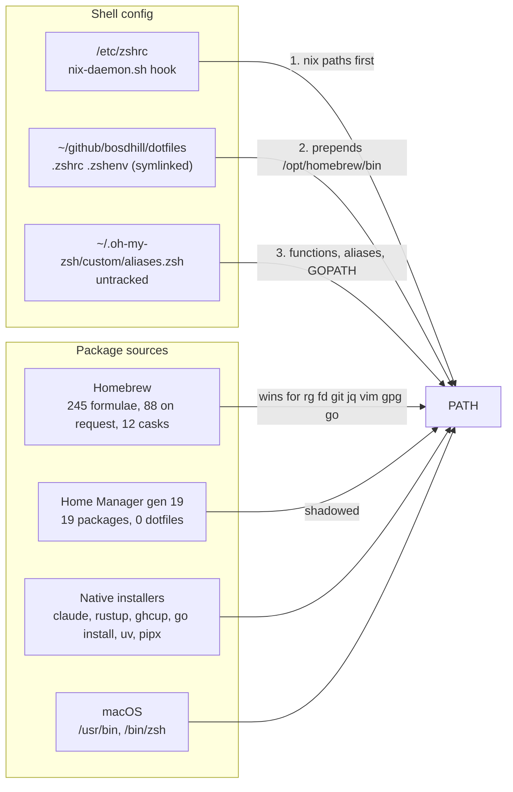
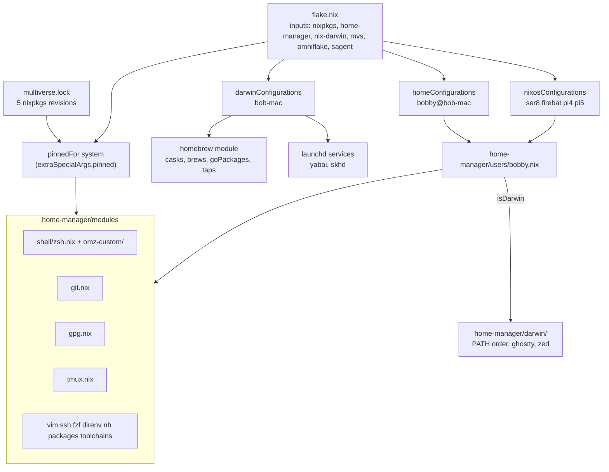
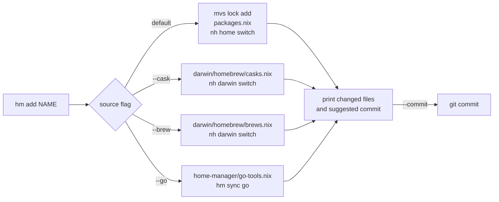
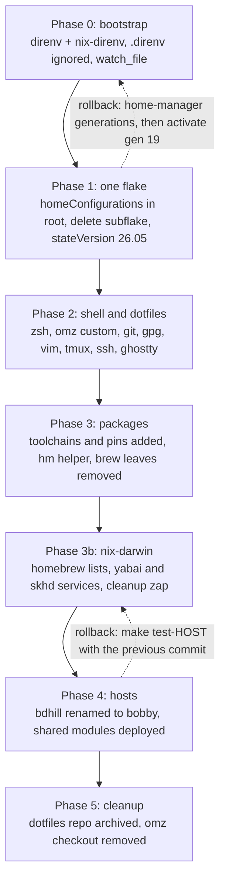

# Home Manager migration plan

Repository: `~/github/catgrep/nixos-config`.
Machine: `bob-mac` (aarch64-darwin, Determinate Nix 3.22.2), user `bobby`.
Shared with: the Linux hosts ser8, firebat, pi4 and pi5, whose account becomes `bobby` as part of this plan.
Prepared 2026-09-27 from a survey of the live home directory, Homebrew, oh-my-zsh, the dotfiles repo, and the locked Home Manager 26.05 sources.
Revised 2026-09-28 after the first review.

## Decisions already taken

- Claude Code stays on its native installer, Codex stays a Homebrew cask.
  Home Manager only puts `~/.local/bin` on PATH.
- One person, one user file: `home-manager/users/bobby.nix` serves the Mac and every Linux host.
  The Linux account is renamed from `bdhill` to `bobby` in Phase 4.
- nix-darwin is adopted for the Mac so Homebrew casks, brew-only formulae, `go install` tools and launchd services are declared in the same flake.
  `nh` drives both layers (`nh home switch`, `nh darwin switch`), wrapped by a small `hm` helper that also drives `mvs lock`.
- Toolchains (Go, Python, Node) come from `multiverse.lock`; Rust comes from `rust-overlay` (chosen over fenix) through the omniflake index, and rustup is uninstalled.
  Haskell is out of scope: ghcup stays as it is and nothing in this plan touches it.
  Tools built with `go install`, `uv tool install` or `cargo install` that nixpkgs lacks are declared in lists `hm` owns and installed by `hm sync` with the pinned toolchains, not through Homebrew.
  `GOPATH` and `GOBIN` stay at `~/go` and `~/go/bin`.
- The git identity is the same signed identity on every machine; the signing subkey reaches the hosts through sops.
- Homebrew cleanup is never automatic: `onActivation.cleanup` stays `"none"`, and `hm brew cleanup` shows the preview and runs the removal only when you ask.
- The account rename runs on all four hosts in one sitting, sequentially, each with its own open root session.
- A Codex review of the plan (2026-09-28, `home-manager-migration-review-codex.md`) found two blockers in the account rename and several gaps in the helper; this revision applies all of its findings.
- `home.stateVersion` moves to `26.05` for `bobby` before the first real switch, so the new XDG defaults apply from day one.
- `multiverse.lock` was minimized on 2026-09-27 (29 revisions to 5, every version unchanged) and committed as `62e633c`.
- The eval-cache finding is written up in `~/scratch/nixos/nix-develop-does-not-populate-eval-cache.md`.
- The uncommitted `/Users/bobby` read path in `flake.nix` is left alone.

## 1. Where things are today

Four package sources and three config sources compete.
Homebrew is prepended to PATH after the Nix hook runs, so brew shadows every Nix copy of the same tool.



Facts that shape the plan:

| Item | Today |
|---|---|
| Duplicated tools (brew formula and a multiverse pin) | coreutils, curl, fd, ffmpeg, git, gnupg, jq, mosh, openssl, prek, ripgrep, rsync, shellcheck, shfmt, sqlite, vim, wget |
| Toolchains from brew | go 1.27.0, node 25.6.1, python 3.12 and 3.13, plus rustup and ghcup natively |
| `.zshrc` | 364 lines, about 40 of real content, an inlined 250-line nfpm completion, four `source <(tool completion zsh)` at every start |
| `.zshenv` | sourced twice, hardcodes a brew llvm@18 Cellar path |
| Shell startup | 0.32s |
| `~/.config/git/ignore` | the same line repeated 49 times |
| Home Manager flake | own `flake.lock`, `stateVersion = "24.11"`, last switch 2026-03-18 |
| Dotfiles repo | 3 commits, dirty since 2025-09 |
| `bdhill` on the hosts | `deploy.yaml`, `/etc/nix/machines`, `modules/common/users.nix`, `hosts/ser8/samba.nix`, two provisioning scripts, one validation script, `secrets/ser8.yaml` |

## 2. Target architecture

One flake, one lock, one user file, one set of Home Manager modules.
The Mac adds a nix-darwin system layer for what Nix cannot install on macOS.
Platform differences live inside the module they affect, gated on `pkgs.stdenv.hostPlatform.isDarwin`.



### Is the config the same on the hosts?

Yes.
`bobby.nix` imports the same module list on every machine, and `pinned` resolves from the same `multiverse.lock`, so versions match too.
The only differences are the ones written into the modules: `homeDirectory` (`/Users/bobby` or `/home/bobby`), the clipboard command in tmux, pinentry, the Homebrew PATH entry, and the `darwin/` files that only exist on the Mac.
Host-only overrides, if any are ever needed, go in `hosts/<host>/home.nix` as a second module, not in a second user file.
Sharing the config means every host's home grows from 5 to 121 packages, including the Rust toolchain, openjdk, zig, ffmpeg and minikube, and the Pis build on target, so their first activation downloads several gigabytes and compiles `tools/hm` locally.
A host that should stay lean gets a `hosts/<host>/home.nix` that excludes the toolchains.

### Proposed tree

```
home-manager/
  default.nix              # imports = [ ./modules ]
  modules/
    default.nix            # imports every file below
    shell/
      zsh.nix              # programs.zsh, oh-my-zsh, dotDir, ZSH_CUSTOM wiring
      omz-custom/
        aliases.zsh        # jpr, gtop, fman, tmosh, capture
        git.zsh            # gsk, gtchk
      completions/         # pre-generated *.zsh files added to fpath
    git.nix                # programs.git: aliases, signing, lfs, osxkeychain on darwin
    gpg.nix                # programs.gpg + services.gpg-agent, pinentry per platform
    tmux.nix               # shared config, copy-command per platform
    vim.nix                # programs.vim, packageConfigurable = pinned.vim, vimrc compiled into the wrapper
    ssh.nix                # programs.ssh.settings, enableDefaultConfig = false
    fzf.nix
    direnv.nix             # programs.direnv + nix-direnv
    nh.nix                 # programs.nh + the hm helper package
    toolchains.nix         # programs.go, python3, nodejs, uv from pinned
    rust.nix               # rust-overlay stable toolchain with rust-src, clippy, rustfmt, rust-analyzer
    packages.nix           # home.packages = map (n: pinned.${n}) (import ../packages.nix)
  packages.nix             # data: Nix list of pinned attribute names, owned by hm
  go-tools.nix             # data: Nix list of "module@version" strings, owned by hm
  uv-tools.nix             # data: Nix list of "package==version" strings, owned by hm
  cargo-tools.nix          # data: Nix list of "crate@version" strings, owned by hm

tools/
  hm/                      # the helper: a Go module, stdlib only, built with buildGoModule
    default.nix            # buildGoModule with pinned.go_1_27, vendorHash = null; installs hm.1 and the completions
    go.mod                 # module github.com/catgrep/nixos-config/tools/hm, go 1.27
    main.go
    internal/
      cli/                 # subcommand table, flag parsing, help rendering, pager
      doc/                 # one struct per subcommand: synopsis, description, examples; feeds --help and the man page
      gendoc/              # `go run ./internal/gendoc` renders doc/ into hm.1 at build time
      nixlist/             # read and write the string-list files hm owns (with golden tests)
      sources/             # inventory: generation, lock, brew lists, go/bin, cargo, uv, native
      txn/                 # lock file, captured files and hashes, restore, run journal
      run/                 # mvs, nh, git, nix eval as typed calls
    hm_test.go
  sagent/                  # existing
  darwin/
    default.nix            # sessionPath, brew PATH after nix, darwin-only packages
    ghostty.nix            # programs.ghostty.settings
    files.nix              # xdg.configFile for zed
  users/
    bobby.nix              # username, homeDirectory per platform, stateVersion 26.05, imports

darwin/                    # nix-darwin system configuration for bob-mac
  default.nix              # system.stateVersion, nix settings left to Determinate, primaryUser
  homebrew/
    default.nix            # homebrew.enable, taps, onActivation; reads the two lists
    casks.nix              # data: Nix list of cask names, owned by hm
    brews.nix              # data: Nix list of formula names, owned by hm
  services.nix             # services.yabai, services.skhd with the existing rc files
```

`users/bdhill.nix` at the repo root is deleted; its `systemConfig` moves to `modules/common/users.nix` under the name `bobby`, and the `home-manager.users.bdhill` block in `flake.nix` that imports it today is replaced by `home-manager.users.bobby = import ./home-manager/users/bobby.nix`.
The old `home-manager/flake.nix` and `home-manager/flake.lock` are deleted.
`pinned` keeps coming through `extraSpecialArgs` because overlays are discarded under `useGlobalPkgs`.

### Root flake wiring

```nix
homeConfigurations."bobby@bob-mac" = home-manager.lib.homeManagerConfiguration {
  pkgs = nixpkgs.legacyPackages.aarch64-darwin;
  extraSpecialArgs = { pinned = pinnedFor "aarch64-darwin"; inherit mvs; };
  modules = [ ./home-manager/users/bobby.nix ];
};

darwinConfigurations."bob-mac" = nix-darwin.lib.darwinSystem {
  system = "aarch64-darwin";
  specialArgs.pinned = pinnedFor "aarch64-darwin";
  modules = [ ./darwin ];
};
```

The NixOS side passes the same two arguments: `home-manager.extraSpecialArgs = { pinned = config.multiverse.locked; inherit mvs; }` in `baseModules`, so `nh.nix` evaluates identically on every machine.
`nix-darwin` comes from the omniflake index (`github:nix-darwin/nix-darwin` is indexed), following the same policy as disko and sops-nix in `omniflake.nix`.
Home Manager stays standalone on the Mac rather than as a nix-darwin module, so `nh home switch` and `nh darwin switch` remain separate, cheap steps.

### The single user file

```nix
# home-manager/users/bobby.nix
{ pkgs, ... }:
let
  darwin = pkgs.stdenv.hostPlatform.isDarwin;
in
{
  imports = [ ../modules ../darwin ];
  home.username = "bobby";
  home.homeDirectory = if darwin then "/Users/bobby" else "/home/bobby";
  home.stateVersion = "26.05";
  programs.home-manager.enable = true;
}
```

`imports` cannot depend on `pkgs`, which is a module argument, so `darwin/` is imported on every platform and each file under it gates its `config` on `pkgs.stdenv.hostPlatform.isDarwin`.

The git identity is the same person everywhere (`Bobby Dhillon`, the gmail address, signing on), so the `catgrep` identity the hosts use today goes away with the rename.
Signing on the hosts needs the private key material there, and that goes through sops: export only the signing subkey (`gpg --export-secret-subkeys --armor <subkey-id>!`), store it as `gpg_signing_subkey` in `secrets/shared.yaml` with `make sops-edit-shared`, declare it in `modules/common` with `owner = "bobby"` and `mode = "0400"`, and let a Home Manager user service import it once:

```nix
# home-manager/modules/gpg.nix, Linux branch
systemd.user.services.gpg-import-signing-subkey = lib.mkIf (!darwin) {
  Unit.Description = "Import the git signing subkey delivered by sops";
  Service = {
    Type = "oneshot";
    ExecStart = "${pinned.gnupg}/bin/gpg --batch --import /run/secrets/gpg_signing_subkey";
  };
  Install.WantedBy = [ "default.target" ];
};
```

The primary key never leaves the Mac, so a compromised host can sign but cannot certify or revoke.
The Mac keeps its full key in `~/.gnupg` as today.
If you want commits from the servers to stay unsigned, that is a one-line `lib.mkIf (!darwin)` in `git.nix`.

### Shared module examples

```nix
# home-manager/modules/shell/zsh.nix
{ config, lib, pkgs, pinned, ... }:
{
  programs.zsh = {
    enable = true;
    package = pinned.zsh;
    dotDir = "${config.xdg.configHome}/zsh";
    history = { size = 50000; save = 50000; ignoreDups = true; ignoreSpace = true; };
    oh-my-zsh = {
      enable = true;
      theme = "fino-time";
      plugins = [ "git" ];
      custom = "${config.xdg.configHome}/oh-my-zsh";
      extraConfig = "ZSH_DISABLE_COMPFIX=true";
    };
    initContent = lib.mkOrder 550 ''
      fpath+=("${config.xdg.configHome}/zsh/completions")
    '';
  };
  home.file."${config.xdg.configHome}/oh-my-zsh" = {
    source = ./omz-custom;
    recursive = true;
  };
  home.file."${config.xdg.configHome}/zsh/completions" = {
    source = ./completions;
    recursive = true;
  };
}
```

```nix
# home-manager/modules/gpg.nix
{ lib, pkgs, pinned, ... }:
let
  darwin = pkgs.stdenv.hostPlatform.isDarwin;
  cacheTtl = 34560000;
in
{
  programs.gpg = { enable = true; package = pinned.gnupg; };
  services.gpg-agent = lib.mkIf (!darwin) {
    enable = true;
    defaultCacheTtl = cacheTtl;
    maxCacheTtl = cacheTtl;
    pinentry.package = pkgs.pinentry-curses;
  };
  home.file.".gnupg/gpg-agent.conf" = lib.mkIf darwin {
    text = ''
      default-cache-ttl ${toString cacheTtl}
      max-cache-ttl ${toString cacheTtl}
      pinentry-program ${lib.getExe' pinned.pinentry_mac "pinentry-mac"}
    '';
  };
}
```

The `services.gpg-agent` launchd unit Home Manager generates puts its sockets under `/private/var/run/org.nix-community.home.gpg-agent/`, which nothing creates and which the Nix gnupg does not use, so on the Mac the module writes `~/.gnupg/gpg-agent.conf` with the TTLs and `pinentry-program` pointing at `pinned.pinentry_mac`, gpg starts the agent on demand, and the service stays Linux-only.

```nix
# home-manager/modules/toolchains.nix
{ config, pinned, ... }:
{
  programs.go = {
    enable = true;
    package = pinned.go_1_27;
    env.GOPATH = "${config.home.homeDirectory}/go";
    env.GOBIN = "${config.home.homeDirectory}/go/bin";
  };
  home.sessionPath = [ "${config.home.homeDirectory}/go/bin" ];
  programs.uv = { enable = true; package = pinned.uv; };
  home.packages = with pinned; [ python3 nodejs_24 pnpm ];
}
```

## 3. Toolchains and tools that are not in nixpkgs

**The Go toolchain was missed in the first survey**, along with node, coreutils, gnupg, ripgrep, shellcheck, openssl, numpy, tesseract and poppler.
The survey keyed on `brew leaves`, which hides any formula that another formula depends on.
`go` is a dependency of hugo, ko and golangci-lint, so it never appeared.
Section 5 now uses `brew list --installed-on-request`, which lists everything you asked for (88 formulae).

**Toolchains** come from `multiverse.lock`: `go_1_27` (1.27.1 indexed), `python3` (3.14.7), `nodejs_24` (24.20.0), `uv` (0.12.11).

**Rust** is managed by Nix through `rust-overlay` (`github:oxalica/rust-overlay`, in the omniflake index, selected in `omniflake.nix` like disko).
`modules/rust.nix` installs `rust-bin.stable.latest.default` extended with `rust-src`, `clippy`, `rustfmt` and `rust-analyzer` as the machine-wide toolchain, and a project that needs a different one gets it from its own `rust-toolchain.toml` through `rust-bin.fromRustupToolchainFile` in that project's dev shell, which direnv loads.
That replaces rustup entirely: the binary, `~/.rustup`, and the `. "$HOME/.cargo/env"` lines in `.zshenv` and `.profile`.
nixpkgs also packages `rustup` itself (1.29.0 indexed) as a fallback, but keeping two toolchain managers defeats the point.
ghcup is out of scope and stays untouched.

**Tools you built with `go install`** split two ways.
Most are packaged: gopls, delve, buf, protoc-gen-go, protoc-gen-go-grpc, gotestsum, gotests, hclfmt, go-licenses, goda, nfpm, mani, diffoci, go-arch-lint, and `go-tools` for staticcheck.
Those become pins and `hm add` handles them.
The rest (gomodifytags and impl are years stale in nixpkgs, kubetest2 and its testers, git-codereview, goplay, arch-go, benchstat, html2markdown) stay as `go install` targets, declared in `home-manager/go-tools.nix` and installed by `hm sync go`:

```nix
# home-manager/go-tools.nix, written by hm, one entry per line, sorted
[
  "github.com/fatih/gomodifytags@v1.17.0"
  "github.com/josharian/impl@v1.4.0"
  "sigs.k8s.io/kubetest2@v0.0.0-20250325"
]
```

`hm sync go` reads each entry, compares it with the module path and version that `debug/buildinfo` reports for the binary already in `~/go/bin`, and runs `go install` with the pinned toolchain only for entries that are missing or differ.
`hm sync go --force` reinstalls every entry regardless, which is how the binaries are rebuilt with the Nix toolchain after the switch, since the inventory records versions and not the compiler that built a binary.

`isocule` is not a `go-tools.nix` entry.
It is a private Gerrit module built from a local checkout, and its binary reports `vcs.modified`, so no `module@version` entry can reproduce it.
It stays a local `go install` build in `~/go/bin`, with `~/bin/iso` and `~/bin/sol` pointing at it, and `hm doctor` reports it as the one known undeclared binary.

nix-darwin's `homebrew.goPackages` was considered and rejected: `brew bundle` installs Homebrew's own `go` formula to run those entries, appends `@latest` itself so versions cannot be pinned, and does not accept `/...` patterns.
Every one of those conflicts with a pinned toolchain.

**Python tools** follow the same model as Go.
`claude-monitor` and `par-cc-usage` are not in nixpkgs, so they are declared in `home-manager/uv-tools.nix` as `package==version` and installed by `hm sync uv` with the pinned `uv` and `python3`; `uv tool list` is the inventory.
pipx goes away, since uv covers it and one installer is enough.
Anything that is in nixpkgs (`python3Packages.*` is not pinnable through mvs, so these come from the nixpkgs input) goes through `python3.withPackages` in `toolchains.nix` when a project needs it.

**What `hm sync` is for.**
It reconciles a declared list with an installer that Nix cannot replace, so a tool with no nixpkgs attribute is still recorded in the repo with its version, comes back on a fresh machine, shows drift in `hm list`, and is built with the pinned toolchain.
It is worth having where the installer is deterministic and the toolchain is pinned: `go install module@version` through the module proxy and checksum database, `uv tool install package==version` against the index, and, once rust-overlay owns the toolchain, `cargo install --locked crate@version` against crates.io.
Most of `~/.cargo/bin` today is in nixpkgs and becomes a pin (cargo-audit 0.22.2, cargo-deny 0.20.2, cargo-watch 8.5.3, cargo-careful 0.4.10, prek); what remains (`wt`, `rustlings`, `cargo-deps`) goes into `cargo-tools.nix` and `hm sync cargo` installs it.

## 4. The `hm` helper

`hm` is a small Go program in `tools/hm/`, next to sagent, with module path `github.com/catgrep/nixos-config/tools/hm` and `go 1.27` in its `go.mod`.
The flake builds it with `buildGoModule` on the pinned `go_1_27` toolchain and installs it through `nh.nix`.
It wraps `mvs lock`, `nh home`, `nh darwin` and the nix-darwin Homebrew lists, so adding anything is one command again.
Go rather than a shell script because every file `hm` edits is a file `hm` must parse back exactly, the inventory needs to read Go build info, and each of those wants a unit test.
The standard library covers all of it (`os/exec`, `debug/buildinfo`, `encoding/json`, `text/template`), so `vendorHash` stays `null` and nothing needs re-vendoring.
The cargo inventory comes from `cargo install --list` rather than parsing `.crates.toml`, since the standard library has no TOML decoder.

### Command-line conventions

`hm` behaves like git and systemctl at the terminal:

- One man page, `hm(1)`, covering every subcommand, every flag, the files `hm` owns, the environment variables it reads (`NH_FLAKE`, `HM_PAGER`, `PAGER`, `NO_COLOR`), exit codes, and an EXAMPLES section per subcommand.
  It is generated at build time from the same `internal/doc` structs that render `--help`, so the two can never disagree; `tools/hm/default.nix` runs `go run ./internal/gendoc` in `postBuild` and installs the result under `$out/share/man/man1/hm.1`.
  Home Manager installs the `man` output of `home.packages`, so `man hm` works after the first switch; `hm help` prints the same page for machines where `man` is not set up.
- `hm --help` lists the subcommands with one line each and three worked examples.
  `hm <subcommand> --help` gives that subcommand's synopsis, every flag with its default, and at least two examples, for instance:

```
$ hm add --help
Usage: hm add [--commit] [--cask | --brew | --go | --uv | --cargo] NAME[@VERSION]

Pin a package and install it.

  --commit      commit the files hm changed with a generated message
  --cask        add a Homebrew cask instead of a nixpkgs attribute
  ...

Examples:
  hm add zizmor                 pin the newest indexed zizmor and switch
  hm add --commit ripgrep@15.1.0
  hm add --cask ghostty
  hm add --go github.com/fatih/gomodifytags@v1.17.0
```

- Long output (`list`, `status`, `doctor`, `help`, `brew cleanup` previews) goes through a pager when stdout is a terminal, in this order: `--no-pager` disables it, then `HM_PAGER`, then `PAGER`, then `less -FRX`.
  Output to a pipe is never paged and never colored; `NO_COLOR` also disables color.
- Exit codes are documented and stable: 0 success, 1 the operation failed and files were restored as far as the failure handling below allows, 2 usage error, 3 refused (dirty owned file, lock held, unresolved previous run), 4 switch succeeded but the commit did not.
- Every subcommand supports `--dry-run`, which prints the commands it would run and the diff it would write.
- `add`, `rm`, `up` and `sync` also take `--build-only`, which does every step except the one that changes the machine: for a nixpkgs attribute it builds the new generation with `nix build` and prints its store path instead of activating it, and for `--go`, `--uv` or `--cargo` it writes and validates the list and prints the `hm sync` command instead of running it; `--commit` stays allowed because the build proved the configuration.
- Flags are parsed with the standard library `flag` package per subcommand; global flags (`--no-pager`, `--dry-run`, `--flake PATH` overriding `NH_FLAKE`) are accepted before or after the subcommand name.
- Shell completion for zsh, bash and fish.
  `hm completion <shell>` prints the script, generated from the same `internal/doc` structs, so subcommands, flags and flag values are always current.
  Names that depend on state are completed dynamically through a hidden `hm __complete <args>` call, the way cobra-based tools do it: `hm rm` and `hm up` complete from the owned lists, `hm add --cask` and `--brew` from `brew search` output cached for a day, and `hm add` without a source flag from the multiverse index through `mvs query`, which reads the local database and returns in well under a second.
  `tools/hm/default.nix` runs the built binary in `postInstall` and installs `_hm` under `share/zsh/site-functions`, `hm` under `share/bash-completion/completions` and `hm.fish` under `share/fish/vendor_completions.d`; Home Manager's zsh module already puts the profile's `site-functions` on `fpath`, so completion works after the first switch with no extra configuration.

### Rules for the shared lock

`multiverse.lock` is shared with the hosts and the dev shell, so `hm` never treats it as its own package list:

- `hm add <attr>` reuses an existing pin when the lock already has one and only calls `mvs lock add` for a new attribute.
  A version given on the command line for an attribute that is already pinned is refused; changing a shared pin is `hm up`.
- `hm rm <name>` removes the name from `packages.nix` only.
  The pin stays in the lock unless `--prune` is given and `hm` has confirmed no other consumer names it (dev.nix, modules, hosts), which it checks with `rg` over the repo before calling `mvs lock rm`.
- `hm up <attr>` is allowed only for attributes present in `packages.nix`; anything else is a host or dev-shell pin and needs `hm up --repo <attr>`, which prints the consumers it will affect first.
  `hm up` with no attribute updates only the `packages.nix` set, never `--all`.
- After `nix flake update mvs`, `hm` runs the refreshed index through `nix run "$NH_FLAKE#mvs" --` rather than the `mvs` already on PATH, which is still the previous generation's build.
  Existing version constraints stay in force, and `hm` reports which pins they held back.
- Both `flake.lock` and `multiverse.lock` are in the printed change set when an update touched them.

```mermaid
sequenceDiagram
  participant U as you
  participant HM as hm
  participant MVS as mvs lock
  participant PK as home-manager/packages.nix
  participant NH as nh home switch
  participant G as git
  U->>HM: hm add zizmor
  HM->>MVS: mvs lock add zizmor
  MVS-->>HM: pinned 1.30.1 at rev 8ce4ef6
  HM->>PK: insert "zizmor" in sorted list
  HM->>NH: nh home switch (nom build, nvd diff)
  NH-->>HM: generation 20
  HM->>G: git status --short multiverse.lock home-manager/
  HM-->>U: added zizmor 1.30.1; uncommitted: multiverse.lock, packages.nix
```



Subcommands:

| Command | Does |
|---|---|
| `hm add <attr>[@version]` | reuse or create the pin, insert the attr in `packages.nix`, `nh home switch`; the success line and the commit carry the version the target system resolves, and when the index version in `multiverse.lock` differs both are printed and recorded in the commit body |
| `hm add --cask <name>` | append to `darwin/homebrew/casks.nix`, `nh darwin switch` |
| `hm add --brew <name>` | append to `darwin/homebrew/brews.nix`, `nh darwin switch` |
| `hm add --go <module@version>` | append to `go-tools.nix`, `hm sync go`; the commit subject names the executable (`home: add go kubetest2-gce v0.0.0-20240905095256`) and the body holds the full `module@version` |
| `hm add --uv <package==version>` | append to `uv-tools.nix`, `hm sync uv`; the commit subject names the package and the body holds the full entry |
| `hm add --cargo <crate@version>` | append to `cargo-tools.nix`, `hm sync cargo`; the commit subject names the crate and the body holds the full entry |
| `hm brew cleanup [--force] [--zap]` | preview what Homebrew would remove against the generated Brewfile; with `--force` remove it, with `--zap` also delete cask data |
| `hm rm [--prune] <name>` | remove from whichever list holds the name, then the matching switch; `--prune` also drops an unreferenced pin |
| `hm up [attr] [--repo]` | `nix flake update mvs`, `mvs lock update` for the named or the `packages.nix` pins, `nh home switch` |
| `hm sync [go|uv|cargo] [--force]` | install or reinstall every `go-tools.nix`, `uv-tools.nix` or `cargo-tools.nix` entry whose binary is missing or at another version; `--force` reinstalls the matching entries too, so the tools are rebuilt with the pinned toolchains |
| `hm switch [home|darwin|all]` | `nh home switch`, `nh darwin switch`, or both, from anywhere |
| `hm list [--source]` | every package in the current Home Manager generation and the imperative sources, with provenance |
| `hm status` | `mvs lock status`, `mvs lock minimize --check`, uncommitted flake files |
| `hm doctor` | walk PATH and report every binary that shadows a Nix one, plus tools present in `~/go/bin`, cargo or uv that no list declares |
| `hm try <attr>` | `nix shell nixpkgs#<attr>`, nothing installed |
| `hm clean` | `nh clean user --keep 5`, refused while the generation 19 root from Phase 1 still exists |

### What `hm list` shows

It reads the Home Manager generation, not the lock, so it shows what is actually installed.
`hm list --generation PATH` reads a built but unactivated generation, such as the path `hm add --build-only` printed.
Each row is tagged with where the package came from:

| Source tag | Meaning | Example |
|---|---|---|
| `pinned` | attribute in `multiverse.lock`, installed through `packages.nix` or a `programs.*` module | ripgrep 15.1.0 |
| `nixpkgs` | from the flake's nixpkgs input, not pinnable (nested attribute sets) | darwin.trash |
| `custom` | built in this repo: `packages/`, `tools/hm`, the sagent subflake | hm, ast-bro, treehouse |
| `cask`, `brew` | declared in `darwin/homebrew/casks.nix` or `brews.nix` | ghostty, docker |
| `go` | every binary in `~/go/bin`, with module path and version read from the binary's build info | gomodifytags v1.17.0 |
| `cargo` | `cargo install --list`, compared with `cargo-tools.nix` | wt 0.3.1 |
| `uv` | `uv tool list`, compared with `uv-tools.nix` | claude-monitor 3.1.0 |
| `native` | on PATH from `home.sessionPath` but managed elsewhere | claude 2.1.274, rustup |

A generation records store paths, not where a package was declared, so `hm` derives provenance itself: a path is `pinned` if `packages.nix` or a `programs.*` module names its attribute and the lock resolves to that path, `nixpkgs` if the attribute is in a module but absent from the lock, and `custom` for everything else in the generation.
The `go`, `cargo` and `uv` rows are read from the machine, not from the flake, so they show what `go install` and friends actually left behind.
A `go`, `uv` or `cargo` row that its list does not declare is marked undeclared, and `hm doctor` lists it.
`hm list --source pinned` and `hm status` together answer "what is pinned but not installed" (host-only pins such as jellyfin) and "what is installed but not pinned".
Custom tools cannot be added with `hm add`; they are a Nix file in `packages/` and show up as `custom` once imported.

### Commits

`hm` does not commit by default.
After every switch it prints the files it changed and a command that runs from any directory, because the flake path comes from `NH_FLAKE` and the commit is scoped to the files `hm` touched rather than to everything in the working tree:

```
hm: switched bobby@bob-mac to generation 20 (zizmor 1.30.1 added)
hm: uncommitted: multiverse.lock home-manager/packages.nix
hm: git -C /Users/bobby/github/catgrep/nixos-config commit -m "home: add zizmor 1.30.1" -- multiverse.lock home-manager/packages.nix
```

The subject is generated from a template, not by a model: layer, verb, name, version.
`home: add zizmor 1.30.1`, `home: update ripgrep 15.1.0 to 15.2.0`, `home: remove charasay`, `darwin: add cask ghostty`, `home: add go gomodifytags v1.17.0`.
`hm add --go` needs an explicit version and refuses `@latest`, so the subject always carries the version it installed.
A tool commit names the executable rather than the module path, keeps only the timestamp of a Go pseudo-version in the subject, and carries the full `module@version` entry in the body, so the eight kubetest2 commands get distinct subjects within 72 characters.
`hm add <attr>` puts the version the target system resolves in the subject and, when `multiverse.lock` records another version for the index, names both in the body (`index 21.0.12.1+1, aarch64-darwin resolves zulu-ca-jdk 21.0.11`).
`hm add --commit` runs that exact command, so the day-to-day path is `hm add --commit zizmor`.
Commits are signed by your normal git config; nothing in `hm` touches signing.

A path-scoped commit records the whole current content of each file, so it would sweep in any edit you had already made to those files.
`hm` therefore refuses to start when a file it is about to own has uncommitted changes, and says which one.

### Failure handling

A run is a transaction around one switch, and every write is a compare-and-swap:

1. `hm` takes an exclusive lock file under `$NH_FLAKE/.git/hm.lock` for the whole run, so two invocations cannot interleave; a second one reports the first's pid and exits.
2. It reads every owned file it will touch and `multiverse.lock`, and keeps the bytes and a content hash of each.
3. Before each write it re-reads the file and compares the hash.
   A mismatch means something else changed the file mid-run; `hm` aborts and writes nothing.
   Writes go to a temporary file in the same directory and are renamed into place, so a crash mid-write leaves the old file intact.
4. Any failure before a generation exists (mvs error, unknown attribute, `nix eval` rejecting the file, a build failure inside `nh home switch`) restores every captured file to its starting bytes and prints the cause.
   A captured file that no longer holds what `hm` last wrote was changed by something else meanwhile; it is left in place, named in the journal, and the run stays unresolved until the file has been looked at.
   `--keep-on-failure` skips the restore for inspecting a build error against the edited files.
5. Once a generation exists nothing is reverted; the generation is the new truth.
   `hm` reads the profile link and the `current-home` root before the switch and again after a non-zero `nh` exit; when they changed, or cannot be read, the restore is skipped, the edited files are kept as the source of what is now active, and the journal records the activated outcome.
   Before an optional commit, `hm` hashes the files once more and refuses to commit if any differ from what it wrote, printing the command instead, so an edit made between switch and commit never rides along under the wrong message.
6. Re-running the same command after a failure is idempotent: an existing pin is reused, a name already in a list is a no-op, and only the switch and the commit happen.

`mvs` edits `multiverse.lock` on its own; `hm` treats it like any other captured file and restores it on failure, which also undoes the pin `mvs lock add` created.

Why this is files and hashes rather than a database: the state that has to stay consistent is written by three other programs (`mvs` writes the lock, Nix reads the lists, `nh` creates the generation), and a SQLite transaction cannot span them.
A database would make its own rows atomic and still need every check above; it would only record that they ran.
Git already holds the durable history of what was installed when.
What `hm` does keep is a run journal, one JSON file per run under `.git/hm/`, with the command, the captured hashes, the step reached and the outcome, so `hm status` can say "last run failed at the switch step and restored two files" and a later run can refuse to start on top of an unresolved one.

```nix
# home-manager/modules/nh.nix (excerpt)
{ config, pkgs, pinned, mvs, ... }:
{
  programs.nh = {
    enable = true;
    package = pinned.nh;
    flake = "${config.home.homeDirectory}/github/catgrep/nixos-config";
    clean.enable = false; # turned on in Phase 5, after rollback has been exercised
  };
  home.packages = [
    mvs.packages.${pkgs.stdenv.hostPlatform.system}.mvs
    (pkgs.callPackage ../../tools/hm {
      inherit (pinned) nh git;
      buildGoModule = pkgs.buildGoModule.override { go = pinned.go_1_27; };
    })
  ];
}
```

```nix
# tools/hm/default.nix
{ buildGoModule, makeWrapper, lib, nh, git }:
buildGoModule {
  pname = "hm";
  version = "0.1.0";
  src = ./.;
  vendorHash = null;
  nativeBuildInputs = [ makeWrapper ];
  postInstall = ''
    wrapProgram $out/bin/hm --prefix PATH : ${lib.makeBinPath [ nh git ]}
  '';
}
```

`programs.nh.flake` sets `NH_FLAKE`, which `nh home`, `nh darwin`, `nh os` and `hm` all read, so one setting covers every layer.
The files `hm` edits are Nix list literals of strings that it owns outright:

```nix
# home-manager/packages.nix, written by hm, one name per line, sorted
[
  "actionlint"
  "apko"
  "ripgrep"
]
```

These data files live outside `modules/` so the module directory's "import every file" rule never sees them.
`home-manager/packages.nix` is consumed by `modules/packages.nix` as `home.packages = map (name: pinned.${name}) (import ../packages.nix);`, and `go-tools.nix`, `darwin/homebrew/casks.nix` and `brews.nix` have the same shape.
The grammar `hm` accepts is exactly that: a bracketed list of double-quoted strings, one per line, with `#` comments allowed between entries; anything else is an error naming the line.
`hm` parses and re-emits them with a round-trip test, then runs `nix eval --json` on the file before switching, so a malformed edit stops before `nh` sees it.
The flake also exports the package as `packages.<system>.hm` so `nix run .#hm` works before Home Manager has installed it.
It exports `packages.<system>.mvs` as well, because `hm up` runs the refreshed mvs through `nix run "$NH_FLAKE#mvs"` after `nix flake update mvs`.

## 5. Package survey

Every Homebrew formula you installed on request (`brew list --installed-on-request`, 88 entries), every cask, native installer, and the current Home Manager list, with a decision.
Nixpkgs attribute names and versions come from the multiverse index on 2026-09-27.

### Move to Home Manager (pinned through multiverse.lock)

| Homebrew | nixpkgs attr | Index version | Note |
|---|---|---|---|
| actionlint | actionlint | 1.7.12 | |
| apko | apko | 1.2.37 | |
| ast-grep | ast-grep | 0.45.1 | |
| bats-core | bats | 1.14.0 | |
| bpm-tools | bpm-tools | 0.3 | |
| cmake | cmake | 4.4.2 | |
| coreutils | coreutils | 9.11 | already pinned |
| cosign | cosign | 3.1.3 | |
| crane | crane | 0.22.0 | |
| curl | curl | 8.21.0 | already pinned |
| dive | dive | 0.13.1 | |
| docker-compose | docker-compose | 5.5.1 | Docker Desktop CLI plugin dir stays |
| doxygen | doxygen | 1.17.0 | |
| eslint | eslint | 10.10.0 | |
| fd | fd | 10.4.2 | already pinned and in Home Manager |
| ffmpeg (+@6, @7) | ffmpeg | 8.1.2 | already pinned; drop the two old majors |
| flock | flock | 0.4.0 | |
| flyctl | flyctl | 0.4.102 | |
| fzf | fzf | 0.74.4 | via `programs.fzf` |
| gh | gh | 2.100.0 | via `programs.gh` |
| git | git | 2.54.0 | already pinned; via `programs.git` |
| git-lfs | git-lfs | 3.7.1 | `programs.git.lfs.enable` |
| gnupg | gnupg | 2.4.9 | already pinned; `programs.gpg` |
| go | go_1_27 | 1.27.1 | `programs.go`; missed in the first survey |
| golangci-lint | golangci-lint | 2.13.2 | |
| grype | grype | 0.119.0 | |
| hugo | hugo | 0.166.0 | completion pre-generated |
| jq | jq | 1.8.2 | already pinned |
| ko | ko | 0.19.1 | |
| macos-trash | darwin.trash | n/a | from the nixpkgs input, not pinnable (nested set) |
| melange | melange | 0.59.2 | |
| minikube | minikube | 1.38.1 | completion pre-generated |
| mosh | mosh | 1.4.0 | already pinned |
| neovim | neovim | 0.12.5 | `neovim-unwrapped` already pinned |
| node, node@22 | nodejs_24 | 24.20.0 | one Node instead of six |
| numpy | python3Packages.numpy | n/a | `python3.withPackages` when a project needs it |
| openjdk | openjdk | 21.0.12.1 | aarch64-darwin resolves zulu-ca-jdk 21.0.11 |
| openssl@3 | openssl | 3.6.3 | already pinned |
| opus-tools | opus-tools | 0.2 | |
| pandoc | pandoc | 3.7.0.2 | |
| pdfgrep | pdfgrep | 2.2.0 | |
| pinentry-mac | pinentry_mac | 1.1.1.1 | `services.gpg-agent.pinentry.package` |
| pnpm | pnpm | 12.3.4 | |
| poppler | poppler-utils | n/a | only if pdftotext is still used |
| prek | prek | 0.5.3 | already pinned |
| pv | pv | 1.11.0 | |
| ripgrep | ripgrep | 15.1.0 | already pinned and in Home Manager |
| ripgrep-all | ripgrep-all | 1.0.0-alpha.5 | |
| rsync | rsync | 3.4.4 | already pinned |
| shellcheck | shellcheck | 0.11.0 | already pinned and in Home Manager |
| shfmt | shfmt | 3.13.1 | already pinned and in Home Manager |
| sox | sox | 14.4.2 | |
| templ | templ | 0.3.1020 | |
| termshot | termshot | 0.6.1 | |
| terragrunt | terragrunt | 1.1.3 | drop the bashcompinit hook |
| tesseract | tesseract | n/a | only if still used |
| testkube | testkube | 2.12.2 | |
| traefik (+@2, @3) | traefik | 3.7.13 | |
| uv | uv | 0.12.11 | `programs.uv` |
| vim | vim | 9.2.0541 | already pinned; `programs.vim` |
| wget | wget | 1.25.0 | already pinned |
| yarn | yarn | 1.22.22 | |
| yt-dlp | yt-dlp | 2026.08.19 | `programs.yt-dlp` |
| zig | zig | 0.16.0 | |
| zizmor | zizmor | 1.30.1 | |
| zsh-completions | zsh-completions | 0.36.0 | added to fpath by `programs.zsh` |
| ast-bro (aeroxy/tap) | sagent flake | 3.0.0 | already provided by the dev shell; remove from brew |

### `go install` tools that become pins

gopls 0.23.0, delve 1.27.2, buf 1.72.0, protoc-gen-go 1.36.12, protoc-gen-go-grpc 1.6.2, gotestsum 1.13.0, gotests 1.9.0, hclfmt 2.25.0, go-licenses 2.0.1, goda 0.9.4, nfpm 2.47.0, mani 0.32.1, diffoci 0.1.8, go-arch-lint 1.19.0, go-tools 2026.2.1 (staticcheck).

### New in Home Manager (not from Homebrew)

| nixpkgs attr | Index version | Purpose |
|---|---|---|
| nh | 4.4.2 | `nh home switch`, `nh darwin switch`, `nh clean` |
| nix-output-monitor | 2.2.0 | build view used by nh |
| nvd | 0.2.4 | generation diff used by nh |
| direnv | 2.37.1 | `programs.direnv` |
| nix-direnv | 3.2.0 | `programs.direnv.nix-direnv.enable` |
| comma | 2.4.2 | run a tool once without installing it |

### Declared through nix-darwin's Homebrew module

| Entry | List | Why not Nix |
|---|---|---|
| anaconda, blackhole-16ch, codex, ghostty, siliconscope, stacktower, syncthing-app, vscodium, wezterm, whatsapp, zed | `homebrew.casks` | GUI apps; Nix on macOS does not manage `.app` bundles well |
| docker | `homebrew.brews` | Docker Desktop owns the CLI and socket |
| openvino, asitop, fprobe, peon-ping, pkgx, gocloc | `homebrew.brews` | tap-only, Darwin-only, or stale in nixpkgs |
| llvm, lld | `homebrew.brews` | `/opt/homebrew/opt/llvm/bin` is on PATH and Homebrew cleanup would otherwise remove them; retained until a Nix C toolchain is decided |
| gomodifytags, impl, kubetest2 and testers, git-codereview, goplay, arch-go, benchstat, html2markdown | `home-manager/go-tools.nix` via `hm sync go` (not Homebrew) | not in nixpkgs or years stale there; `isocule` is the local build exception described in section 3 |
| borders | `services.jankyborders` (nix-darwin, Phase 3b) | the nixpkgs `jankyborders` binary under the nix-darwin service, which owns the launchd agent |
| peonping/tap, stacktower-io/tap | `homebrew.taps` with `trusted = true` | needed by peon-ping and stacktower; Homebrew refuses a formula or cask from a third-party tap it has not been told to trust |

yabai, skhd and borders move to nixpkgs binaries under nix-darwin's `services.yabai`, `services.skhd` and `services.jankyborders`, which own the launchd agents and read your existing rc files.
The `tailscale` launch agent goes with the Tailscale app.
`hm brew cleanup --force` removes anything not in the lists, which is how the 150 dependency leftovers (gcc, six Node majors, five OpenSSL versions, four kubectl versions) disappear; activation itself removes nothing.

Ten library formulae are left for Homebrew cleanup: `aom`, `flac`, `glib`, `harfbuzz`, `jpeg-xl`, `libass`, `libffi`, `libsoxr`, `opus` and `pango`.
Homebrew marks them installed on request because they were installed as build dependencies of formulae that now come from Nix, and nothing declared consumes them, so the first `hm brew cleanup --force` removes them.
`numpy`, `poppler`, `tesseract` and `python-requests` are the user's decision before the first `hm brew cleanup --force`, because cleanup removes them otherwise; keeping one means declaring it, as a pin or with `hm add --brew`.
`omlx` is not installed on this machine, only its tap `jundot/omlx` is, so it is not declared; `hm add --brew omlx` adds it later if wanted, and cleanup untaps `jundot/omlx`.
Cleanup also untaps `felixkratz/formulae` and `homeport/tap`, whose borders and html2markdown now come from Nix.
The `syncthing` entry that `brew list --cask` shows is a symlink to `syncthing-app`, which is the declared cask.

### Native installers (unchanged)

| Tool | Location | Why |
|---|---|---|
| Claude Code | `~/.local/share/claude`, symlink in `~/.local/bin` | self-updating; Home Manager adds the path |
| Codex | Homebrew cask, declared in `homebrew.casks` | `brew upgrade` tracks releases faster than nixpkgs |
| ghcup, cabal, stack | `~/.ghcup`, `~/.cabal` | out of scope; untouched |

rustup is not in this table any more: the Rust toolchain comes from rust-overlay (section 3), `~/.rustup` is removed in Phase 3, and `~/.cargo/bin` holds only `cargo install` output declared in `cargo-tools.nix`.
| uv tools | `~/.local/share/uv`, declared in `uv-tools.nix` | claude-monitor, par-cc-usage (moved from pipx); not in nixpkgs |

### Already in Home Manager, keep

ripgrep, fd, bat, nixfmt, nixd, nil, charasay, gitingest, colmena, colima, openssh, openssl, shellcheck, shfmt, nmap, yq-go, addlicense, jujutsu, just.

## 6. Config files ported

| Today | Becomes |
|---|---|
| `~/.zshrc` (symlink to dotfiles) | `programs.zsh` in `shell/zsh.nix`; file lands at `~/.config/zsh/.zshrc` |
| `~/.zshenv` (symlink to dotfiles) | `home.sessionPath`, `home.sessionVariables`; Home Manager writes a two-line `~/.zshenv` |
| `~/.zprofile` (pipx line) | `home.sessionPath` |
| `~/.profile` (cargo env) | `home.sessionPath` includes `~/.cargo/bin` |
| `~/.oh-my-zsh/custom/aliases.zsh` | `shell/omz-custom/aliases.zsh` and `git.zsh` |
| `~/.gitconfig` | `programs.git.settings`, `signing`, `lfs`, `includes` |
| `~/.gitignore_global`, `~/.config/git/ignore` | `programs.git.ignores` (one copy) |
| `~/.gnupg/gpg-agent.conf` | `services.gpg-agent` |
| `~/.vimrc` | `programs.vim.extraConfig`, compiled into the wrapper through `packageConfigurable = pinned.vim` because `programs.vim.package` is read-only; no `~/.vimrc` is written |
| `~/.ssh/config` (3 hosts) | `programs.ssh.settings` with OpenSSH directive names, `enableDefaultConfig = false` |
| Ghostty config | `programs.ghostty.settings` (package left null, cask stays) |
| `~/.config/yabai/yabairc`, `~/.config/skhd/skhdrc` | `services.yabai.extraConfig`, `services.skhd.skhdConfig` in nix-darwin |
| `~/.config/zed/settings.json`, `keymap.json` | `xdg.configFile` |
| tmux (none on the Mac today) | `tmux.nix` shared with the hosts, `pbcopy` on darwin |
| `~/.npmrc` prefix, `~/.yarnrc` | `home.file` |
| `~/Brewfile` (2023) | `darwin/homebrew/` |

## 7. Migration phases



### Phase 0: bootstrap direnv

1. `mvs lock add direnv`, `mvs lock add nix-direnv`, `mvs lock add nh`, `mvs lock add nix-output-monitor`, `mvs lock add nvd`; add direnv through `programs.direnv` and the other three to `home.packages` in the current `home-manager/default.nix`; switch once with the old flake.
   This is the bootstrap: Phase 1 runs `nh` from this generation.
2. Add `.direnv/` to `.gitignore`.
3. Extend `.envrc`:

```bash
watch_file dev.nix multiverse.lock tools/sagent/flake.nix tools/sagent/flake.lock tools/sagent/outputs.nix
use flake
```

4. `direnv allow`, open a new shell, confirm `sb` and `mvs` resolve without `make dev`.
   Home Manager writes the direnv hook into `programs.zsh.initContent`, which stays inert until Phase 2 enables `programs.zsh`, so until then add `eval "$(direnv hook zsh)"` to the unmanaged dotfiles `.zshrc` by hand.
   Phase 2 removes that line again when Home Manager takes over zsh.

Verify: `time zsh -ilc exit` under 0.5s, entering the repo prints the direnv line and nothing evaluates.

### Phase 1: one flake, new state version

1. Keep generation 19 reachable for the whole migration: `nix build --out-link ~/.local/state/home-manager/keep-gen19 /nix/store/pa2s5qbgbncw97vky87nznmqgxqf3ik7-home-manager-generation` registers a GC root that `nh clean` cannot collect.
2. Add `homeConfigurations."bobby@bob-mac"` to `flake.nix`, pointing at `home-manager/users/bobby.nix` with `stateVersion = "26.05"`.
3. Move the package list into `home-manager/packages.nix` unchanged.
4. Delete `home-manager/flake.nix`, `home-manager/flake.lock`; update `make home-switch` to `nh home switch .`; update `make update`.
5. `nix build '.#homeConfigurations."bobby@bob-mac".activationPackage'` first, because `nix flake check` does not evaluate that output.
6. `nh home switch . -b bak` from the repo root on the first run, so any file Home Manager wants to own is backed up rather than refused.
   nh detects `bobby@bob-mac` from the user and the LocalHostName, so no configuration flag is needed.

Verify: the new generation (21 on this machine) resolves to the activation package that `nix build` printed, with the same packages as generation 20 (`nvd diff` shows only the `home-manager-applications` entry that state version 26.05 adds through `copyApps`); the activation package builds; `nix flake check` on aarch64-darwin passes with only the known unknown-output warnings; `~/.local/state/home-manager/keep-gen19` resolves.

### Phase 2: shell and dotfiles

1. Remove the `~/.zshrc` and `~/.zshenv` symlinks (they point into the dotfiles repo; the repo stays until Phase 5) and move `~/.gitconfig` aside, because git reads it in addition to `~/.config/git/config` and it would shadow the managed config.
   After the switch, copy `~/.zsh_history` to `~/.config/zsh/.zsh_history`, since history lives under `dotDir`, and run `gpgconf --kill gpg-agent` so the new pinentry takes effect.
2. Write `shell/zsh.nix` and `omz-custom/` from the 40 real lines of the current config.
   Drop: the nfpm completion, `source ~/.zshenv`, the travis hook, the `bdhill` PATH entries, the anaconda comment, `/usr/local/sbin`.
   Keep: `gsk`, `gtchk`, `tmosh`, `capture`, `jpr`, `gtop`, `fman`, `GPG_TTY`, `EDITOR`, `BUILDX_BAKE_ENTITLEMENTS_FS`, `BINDGEN_EXTRA_CLANG_ARGS`, ghostty and iterm integration guarded by their env vars.
3. Generate completions once into `completions/` (`nfpm completion zsh`, `hugo completion zsh`, `minikube completion zsh`, `docker completion zsh`, `kubectl completion zsh`) instead of sourcing them per shell.
4. `git.nix`, `gpg.nix`, `vim.nix`, `tmux.nix`, `ssh.nix`, `fzf.nix` from the files listed in section 6.
   `ssh.nix` uses `programs.ssh.settings` with OpenSSH directive names and `enableDefaultConfig = false`, because `programs.ssh.matchBlocks` is deprecated in the locked Home Manager (`modules/programs/ssh.nix:855`).
5. `darwin/ghostty.nix` and `darwin/files.nix` for zed.
6. Switch, open a new terminal, run `gsk --help`, `git lg`, sign a test commit, confirm `pinentry-mac` prompts.

Verify: `zsh -ilc 'echo $ZDOTDIR'` prints `~/.config/zsh`; startup under 0.25s; a signed commit works.

### Phase 3: packages and the helper

1. `toolchains.nix` with `go_1_27`, `python3`, `nodejs_24`, `uv`, and `rust.nix` with the rust-overlay stable toolchain; switch; confirm `go version`, `node --version`, `cargo --version` and `rust-analyzer --version` resolve under the Nix store.
   Then `rustup self uninstall`, which removes `~/.rustup` and the rustup-managed proxies in `~/.cargo/bin` but keeps `cargo install` output; the `. "$HOME/.cargo/env"` lines are already gone with Phase 2.
2. `nh.nix` with `programs.nh`, `mvs` on PATH, and the first version of `hm` (add, rm, up, switch, list, status, doctor, try, clean) with `go test ./...` passing and wired into `checks`.
3. For each plain CLI row in section 5 marked "move": `hm add --commit <attr>`.
   From an agent session the migration runs `hm add --build-only --commit <attr>` for each row, so every addition is built and committed without activating, and the user activates once at the end with `hm switch`.
   Four kinds of row do not go through `hm add` and are handled by hand in this step: attributes a `programs.*` module installs (git, gh, fzf, vim, gpg, uv, yt-dlp, go), Darwin-only attributes that need an `isDarwin` guard (`pinentry_mac`), nested attributes the lock cannot hold (`darwin.trash`, from the nixpkgs input), and ast-bro, which the sagent subflake exports and which `darwin/default.nix` adds to `home.packages` from `sagent.packages`.
   Once the Nix hugo, minikube and nfpm are installed, regenerate their completions in `modules/shell/completions/` from those binaries.
4. `hm add --go` for each `go install` tool in section 5, `hm add --uv claude-monitor==<version>` and `par-cc-usage` followed by `brew uninstall pipx` and `trash ~/.local/pipx`, and `hm add --cargo` for `worktrunk` (the `wt` binary), `rustlings` and `cargo-deps`.
   After the activation the user runs `hm sync cargo --force` and `hm sync go --force`, which rebuild every declared tool with the Nix toolchains, because a plain sync skips an entry whose installed version already matches.
   Then `cargo uninstall cargo-audit cargo-careful cargo-deny cargo-watch prek`, because their `~/.cargo/bin` copies became pins, and `trash ~/go/bin/{gopls,dlv,buf,protoc-gen-go,protoc-gen-go-grpc,gotestsum,gotests,hclfmt,go-licenses,goda,nfpm,mani,diffoci,go-arch-lint,staticcheck}` for the fifteen Go binaries that became pins.
   `programs.gh` owns `~/.config/gh/config.yml`, so the file is moved aside before the switch and its settings are ported into `programs.gh.settings`.
   The conditional rows (numpy, poppler-utils, tesseract, python-requests) are the user's decision.
5. Verify the PATH order, which `darwin/default.nix` does not need to change: `home.sessionPath` prepends its entries from `.zshenv`, `path_helper` then places the system directories first, and the `/etc/zshrc` Nix hook prepends the Nix profiles, so from the Phase 2 switch on the order is Nix profiles, system directories, session path entries with `/opt/homebrew/bin` last.
   Because Homebrew now sits after `/usr/bin`, every Homebrew tool that overrides an Apple system tool today (python3, rsync, curl, make, openssl, coreutils) must have moved to a pin before Phase 3 ends.

Verify: `command -v rg fd git jq vim gpg go node` all resolve under `/nix/store` or `~/.nix-profile`; `hm list` shows every row with the right source tag; `hm doctor` reports nothing undeclared in `~/go/bin`.

### Phase 3b: nix-darwin

1. Add `nix-darwin` to `omniflake.nix`, `darwinConfigurations."bob-mac"` to `flake.nix`, and the `darwin/` directory with `homebrew.nix` written from the "declared through nix-darwin" table and `services.nix` for yabai, skhd and borders (`services.jankyborders`).
   The skhd and yabai rc files in `darwin/` are the live files minus the bindings that pointed at scripts under another user's home directory, which never existed here.
   Leave `nix.*` settings to Determinate (`nix.enable = false`) so nix-darwin does not fight the installer over `/etc/nix/nix.conf`.
2. `brew services stop yabai skhd borders`, then `nh darwin switch`; nix-darwin's launchd agents take over.
3. `homebrew.onActivation.cleanup` stays `"none"` permanently, and `homebrew.global.brewfile = true` so plain `brew bundle` commands read the generated Brewfile.
   Removal is a manual, previewed step you run whenever you decide to.
   Before the first preview, run `brew trust peonping/tap stacktower-io/tap` once: `brew bundle cleanup` loads the declared formulae before anything has applied the Brewfile's trust flags, which only the install step of a switch does, so an untrusted tap stops the preview.
   `hm brew cleanup` names that prerequisite when it is missing, and trusting a tap is a one-time local Homebrew setting, not a change to the lists.

```bash
hm brew cleanup            # preview: every formula, cask and tap not in darwin/homebrew/ that Homebrew would remove
hm brew cleanup --force    # remove them; cask data and preferences are left in place
hm brew cleanup --force --zap   # remove them and delete cask data too
```

   Under the hood that is `brew bundle cleanup` against the generated Brewfile, without and with `--force`, and `--zap` adds `--zap`.
   `brew bundle check` is not a substitute: it only confirms declared entries are installed and says nothing about what cleanup would remove.
   Compare the preview with `brew list --installed-on-request` and `brew list --cask` before the first `--force`; the roughly 150 dependency leftovers (gcc, six Node majors, five OpenSSL versions, four kubectl versions) are expected there, while llvm and lld stay because `homebrew.brews` lists them.
   The preview also lists `jundot/omlx`, the tap of an `omlx` that was never installed here; `hm add --brew omlx` adds the formula later if wanted, and cleanup untaps it otherwise.
4. Extend `hm` with `--cask`, `--brew`, `brew cleanup` and `switch darwin`.

Verify: `hm brew cleanup` prints only entries you expect to lose; `launchctl list | grep -E 'yabai|skhd'` shows the nix-darwin agents; `hm add --cask --commit <name>` round-trips.

### Phase 4: hosts share the config and the account is renamed

The rename is the one live-host mutation in this plan and needs your go-ahead; it runs on all four hosts in one sitting, sequentially, and a host is not started until the previous one has passed its verification.
Two constraints shape the order.
NixOS rejects two accounts with the same uid, so `bdhill` and `bobby` cannot coexist at uid 1000; the rename is one configuration change that removes one and adds the other.
And `createHome` runs during activation, so an empty `/home/bobby` appears the moment the new configuration activates; the home directory must already be in place before that, or the later `mv` lands inside it.
pi5 deploys as the `nixos` user today, not `bdhill`, so it only needs the config change.

Preparation, once, in the repo:

1. `modules/common/users.nix`: rename the account to `bobby`, same `uid = 1000`, groups and SSH key; `home-manager.users.bobby` imports `home-manager/users/bobby.nix`; `users/bdhill.nix` is deleted.
2. `hosts/ser8/samba.nix`: `valid users`, the smbpasswd block, and the secret renamed to `samba_bobby_password` in `secrets/ser8.yaml` with `make sops-edit-ser8`; the two provisioning scripts and the validation script.
   The Samba secret keeps the key name `samba_bdhill_password` until `make sops-edit-ser8` renames it and the one-line follow-up lands in `hosts/ser8/samba.nix`, and `modules/common/signing-key.nix`, which declares `gpg_signing_subkey`, is committed only after `make sops-edit-shared` has added the key, because sops-nix validates key presence at build time.
3. Do not touch `deploy.yaml` or `etc/nix/machines` yet; a host's `targetUser` changes in its step 10, and the machines file changes after all four hosts.
4. `make build-HOST` for all four hosts.

Then, for ser8, firebat, pi4 and pi5 in that order, each in one SSH session that stays open throughout:

5. `ssh bdhill@HOST`, then `sudo -i`.
   The session survives the account's removal because the process already exists; a second terminal with a root shell is the fallback.
6. Snapshot or back up the home storage: on ser8 `zfs snapshot rpool/safe/home@pre-rename`; on firebat (ext4 home) `tar` it into `/persist`; on the Pis a tarball is enough.
7. Stop the old account's other sessions from the root shell, then `mv /home/bdhill /home/bobby`.
   `loginctl terminate-user bdhill` is not an option here, because it ends every session scope of that user, including the one the `sudo -i` shell from step 5 runs in.
   Run `loginctl list-sessions`, then `loginctl terminate-session <id>` for every `bdhill` session except the one whose id is `$XDG_SESSION_ID`.
   If `sudo -i` has dropped that variable, `loginctl session-status` with no argument prints the caller's session from the root shell.
   uid 1000 does not change, so ownership needs no fixing.
8. From the Mac, `make test-HOST`.
   It connects as the user `deploy.yaml` names, which is still `bdhill` on ser8, firebat and pi4, so `NIXBUILD_USER` is not needed.
   pi5 deploys as `nixos`, an account no configuration declares, so it has no `/home/bdhill` to move and only `bobby` exists after its first activation.
   Activation finds `/home/bobby` present, drops `bdhill`, and Home Manager activates for `bobby`.
9. From a new terminal on the Mac: `ssh bobby@HOST sudo true`.
   If that fails, activate the previous generation from the still-open root shell (`/nix/var/nix/profiles/system-<n>-link/bin/switch-to-configuration test`), move the directory back, and stop.
10. Only after the new login works: `make switch-HOST`, then close the old session.
    On ser8 the `samba-password-sync` oneshot sets the Samba password for `bobby` during activation, because its script changed, so what remains manual is `sudo smbpasswd -x bdhill` to drop the old Samba account.
    Then set the host's `targetUser` in `deploy.yaml` to `bobby` (pi5 from `nixos`), because the ser8 and gateway smoketests connect as that user.

After all four hosts:

11. Update `etc/nix/machines`, run `make update-nix-conf`, and confirm a remote build from the Mac with `nix build --builders @/etc/nix/machines` on an x86_64-linux derivation.
12. Deploy the sops-delivered signing subkey (section 2) and confirm `git commit --allow-empty -m test` signs on each host.
    pi5 is not a recipient of `secrets/shared.yaml`, since `.sops.yaml` lists pi4, firebat and ser8, so before the subkey can reach it run `make sops-add-host-keys` for pi5 and `make sops-update-keys` to re-encrypt the shared file.
    On each host the import unit runs at the next session start, or `systemctl --user start gpg-import-signing-subkey` runs it at once.
    A subkey with a passphrase prompts once through pinentry-curses over the ssh tty, and the 400-day cache then holds.
13. Restore the snapshot on any host that needs a second attempt; otherwise delete it after a week.

Verify per host: `ssh bobby@HOST`, `make smoketests-HOST`, `nix eval '.#nixosConfigurations.HOST.config.home-manager.users.bobby.programs.zsh.dotDir'` prints the XDG path, Samba login as `bobby` on ser8, and a reboot brings the host back with `/home/bobby` mounted.
The smoketests connect as the `deploy.yaml` user, so the `targetUser` change in step 10 comes before them.
The Pi suite in `scripts/smoketests/pi/` checks login, sudo and the remote builder, and also honours `NIXBUILD_USER=bobby`, so it can run before `deploy.yaml` changes.

### Phase 5: cleanup

1. Archive `~/github/bosdhill/dotfiles` (tag, push, remove the checkout) once nothing references it.
2. `trash ~/.oh-my-zsh`; Home Manager provides `pkgs.oh-my-zsh`.
3. `trash ~/.zshrc.pre-oh-my-zsh`, `~/.zcompdump*`, the `latest` symlink, `~/Brewfile` (2023).
4. Update `CLAUDE.md`: remove the subflake and `bdhill` notes, document `hm` and `nh`.
5. Exercise a rollback once (activate generation 19 from its GC root, then switch forward again); then remove `keep-gen19`, set `programs.nh.clean.enable = true` with `--keep 5`, and switch.

## 8. Performance

| Measurement | Before minimize | After minimize |
|---|---|---|
| nixpkgs trees evaluated for the dev shell | 14 | 8 |
| `nix develop`, eval cache cold | 8.2s | 6.0s |
| `nix develop`, eval cache warm | 0.75s | 0.75s |
| Home Manager activation eval, cold | 10.6s | 5.8s |
| Revisions in `multiverse.lock` | 29 | 5 |

The remaining eight trees are three multiverse revisions, nixpkgs-unstable, one each for ast-bro, treehouse and claude-code-sandbox (preserved upstream locks), and one the mvs CLI fetches for itself.
The cache is warm only if something other than `nix develop` populated it; see the issue file.
With direnv the shell is entered from nix-direnv's cache, so the cold cost is paid once per change to a watched file.
`hm add` will drift the lock apart again over time; `hm status` reports the `minimize --check` result so you can run `mvs lock minimize` deliberately.

## 9. Risks and rollback

- Home Manager refuses to overwrite files it does not own.
  Remove the `.zshrc` and `.zshenv` symlinks before Phase 2 or pass `-b bak`.
- GPG signing depends on `pinentry-mac` being found by the agent; keep the brew copy until the Nix one prompts once.
- The `ccode` function calls `claude update`; it keeps working because Claude stays native.
- Generation 19 is protected by an explicit GC root from Phase 1, and `nh clean` stays disabled until Phase 5; keeping five generations would not have been enough across the dozens of switches in Phase 3.
- Homebrew cleanup is never run by activation; `hm brew cleanup --force --zap` deletes cask data, so read the preview first.
- The account rename touches Samba, SSH, remote builders and the persisted home dataset; all four hosts in one sitting, one at a time, each with a root session kept open and the home directory moved before activation.
- Removing rustup removes every toolchain it managed; make sure `cargo --version` resolves to the Nix toolchain before `rustup self uninstall`.
- The signing subkey on the hosts is readable by `bobby` only, but a host compromise can then produce signed commits; the primary key stays on the Mac so the subkey can be revoked.
- State version 26.05 turns on `targets.darwin.copyApps`, which copies `.app` bundles into `~/Applications/Home Manager Apps` and checks App Management permission for the terminal; expect a one-time macOS prompt.
  It does not move `~/.gnupg` under XDG; `programs.gpg.homedir` stays at the default.
- Rollback for Home Manager is `home-manager generations` and activating the previous generation's `activate` script; for nix-darwin it is `darwin-rebuild --rollback`; for hosts it is `make test-HOST` on the previous commit.

## 10. Decisions from review

All closed on 2026-09-28; nothing is open.

1. `GOPATH=~/go` and `GOBIN=~/go/bin` stay as they are.
2. One signed git identity everywhere; the signing subkey reaches the hosts through sops.
3. Homebrew cleanup is manual and previewed through `hm brew cleanup`; activation never removes anything.
4. The account rename runs on all four hosts in one sitting.
5. Rust is Nix-managed through rust-overlay (not fenix); rustup is removed; `cargo install` tools get `hm sync cargo`.
6. `hm` keeps its state in files, hashes and a JSON run journal, not a database.
7. Haskell and ghcup are out of scope.
8. `hm` ships a generated man page, per-subcommand `--help` with examples, and pager handling like git.

## 11. Implementation notes for agents

This plan is meant to be executed by agents in fresh sessions, one phase per session or less.
Everything an agent needs that is not in `CLAUDE.md` is here.

### Ground rules

- Work on local `main`; never push, never open a pull request, never amend a commit that already existed when the session started.
- Never sign commits from an agent session (`-S`, `--gpg-sign`, or leaving `commit.gpgsign` on); run git with `-c commit.gpgsign=false`.
  The user re-signs afterwards with a date-preserving rebase.
- Never add an agent as co-author.
- Human checkpoints, where the agent stops and asks: every command that mutates a live host (Phase 4 in full, `make switch-HOST`, `make test-HOST`), entering secret material (`make sops-edit-shared`, the subkey export), the first `nh darwin switch` (it takes over `/etc` files and launchd), `rustup self uninstall`, and `hm brew cleanup --force`.
  Repo edits, builds, evaluations, dry runs, tests, and `nh home switch` on the Mac need no confirmation: a Home Manager switch is user-level and one generation away from rollback.
- Human-gated work is grouped at the end of the run, not interleaved: agents complete everything that is repo-only or Mac-user-level first (Phases 0 to 3, the repo side of 3b and 4, the docs of 5), then the user works through the gated list in one sitting with the agent preparing each command.

### Orchestration

One orchestrator session manages the run and does not edit files itself.
It spawns one sub-agent per phase with a fresh context, hands it this document and the phase name, waits for its report, and reviews the result before the next phase starts.
Between phases the orchestrator runs a Codex review of the diff since the previous review, with sandboxing off, and has the phase's sub-agent (or a new one) apply the findings that hold up:

```bash
codex exec --dangerously-bypass-approvals-and-sandbox --ephemeral --skip-git-repo-check \
  -C "$NH_FLAKE" --color never -o .planning/reviews/phase-N-codex.md - <<'EOF'
Review the commits since <sha> in this repository against .planning/home-manager-migration-plan.md, phase N.
Do not modify files. Verify option names against the locked Home Manager and nix-darwin sources in the Nix store.
Report a ranked list: severity, file:line, what is wrong, evidence, concrete fix. Under 1200 words.
EOF
```

The review file is committed with `planning: record the codex review of phase N`.
Findings the orchestrator rejects are listed in that commit's body with the reason.
The gated list at the end is executed in the orchestrator's own session, one command at a time, each shown to the user before it runs.
- In the sagent sandbox, `nix` commands that fetch, lock or evaluate impurely need `export XDG_CONFIG_HOME=<scratchpad>/xdg` first.
- Nix files: `nixfmt-rfc-style` formatting, `statix` clean, `SPDX-License-Identifier: GPL-3.0-or-later` header, lowercase kebab-case filenames, one small module per concern imported through the directory's `default.nix`.
- Comments state the present design and its reason; no change history ("previously", "used to"), no references to planning phases or this document.
- Shell: `set -euo pipefail`, `shellcheck` and `shfmt -d` clean.
- Go (`tools/hm`): standard library only, `gofmt`, `go vet`, `staticcheck` (from the `go-tools` pin) clean, table tests with golden files for every file format `hm` owns, functions under 100 lines, no package-level mutable state.
  `buildGoModule` runs `go test ./...` as its check phase, and `checks.<system>.hm` in `checks.nix` builds the package so `make check` covers it.
- Every phase ends with `make fmt`, `make check` (or the narrower command the phase names), and the phase's own Verify line satisfied, before the last commit of the phase.

### Commit messages

Match the style already in the history: an area prefix, a colon, an imperative subject in lower case, no trailing period.
The subject line is at most 72 characters, and the body, when there is one, wraps at 72 columns; some existing commits exceed that and are being cleaned up separately, so do not copy them.
One logical change per commit.
Area prefixes used by this plan:

| Prefix | Scope | Example |
|---|---|---|
| `home:` | `home-manager/` modules, users, data lists | `home: add zsh module with oh-my-zsh custom dir` |
| `hm:` | `tools/hm` | `hm: add sync subcommand for go tools` |
| `darwin:` | `darwin/`, nix-darwin wiring | `darwin: declare homebrew casks and taps` |
| `flake:` | `flake.nix`, `omniflake.nix`, inputs | `flake: export homeConfigurations for bob-mac` |
| `multiverse:` | `multiverse.lock` changes made by hand through `mvs` | `multiverse: pin direnv, nix-direnv and nh` |
| `users:` | `modules/common/users.nix`, account rename | `users: rename the host account to bobby` |
| `secrets:` | sops files | `secrets: add the git signing subkey for hosts` |
| `smoketests:` | `deploy.yaml` tests | `smoketests: check login and sudo on the pis` |
| `docs:`, `planning:` | `CLAUDE.md`, `.planning/` | `docs: describe hm and nh in the repo guide` |

The subjects `hm` generates (`home: add zizmor 1.30.1`) follow the same rule and are truncated at 72 characters with the version kept.

### Order of work and expected commits

| Phase | Session deliverable | Commits, in order |
|---|---|---|
| 0 | direnv, nix-direnv, nh, nom, nvd pinned and installed through the old flake; `.envrc` extended | `multiverse: pin direnv, nix-direnv, nh, nom and nvd`; `home: enable direnv and install nh`; `flake: ignore .direnv and watch the dev shell inputs` |
| 1 | root-flake `homeConfigurations`, subflake deleted, state version 26.05, GC root for gen 19 | `flake: export homeConfigurations for bob-mac`; `home: move the package list to packages.nix`; `home: delete the standalone subflake`; `docs: point home-switch at nh` |
| 2 | shell, git, gpg, vim, tmux, ssh, fzf, ghostty, zed modules; symlinks removed by hand | one `home:` commit per module, `home: add omz custom functions and aliases` |
| 3 | toolchains, rust-overlay, `tools/hm` with tests and `checks` wiring, packages migrated, PATH order | `flake: select rust-overlay from the omniflake index`; `home: add toolchains and rust modules`; `hm: scaffold the module and the txn package`; `hm: add add, rm and up`; `hm: add list, status and doctor`; `hm: add sync for go, uv and cargo`; `hm: generate the man page and per-subcommand help`; `hm: add shell completion for zsh, bash and fish`; `flake: build and check tools/hm`; then the `home: add <pkg>` commits `hm` generates |
| 3b | nix-darwin, Homebrew lists, yabai and skhd services, `hm brew cleanup` | `flake: select nix-darwin from the omniflake index`; `darwin: add the bob-mac system configuration`; `darwin: declare homebrew casks, brews and taps`; `darwin: run yabai and skhd as launchd services`; `hm: add brew cleanup with a preview` |
| 4 | account rename prepared in the repo, then executed with the user host by host | `users: rename the host account to bobby`; `secrets: add the git signing subkey for hosts`; `smoketests: check login and sudo on the pis`; after cutover `deploy: connect to hosts as bobby` |
| 5 | cleanup, docs, `nh clean` enabled | `docs: describe hm and nh in the repo guide`; `home: enable nh clean after the rollback test` |

### The gated list, in order

Run after every agent phase is committed and reviewed:

1. `nh darwin switch` for the first time (Phase 3b), then `hm brew cleanup` preview and, when satisfied, `hm brew cleanup --force`.
2. `rustup self uninstall` after `cargo --version` resolves to the Nix toolchain (Phase 3).
3. Export the signing subkey and enter it with `make sops-edit-shared` (Phase 4 preparation).
4. The account rename on ser8, firebat, pi4, pi5 in that order (Phase 4), then `deploy.yaml` and `etc/nix/machines`.
5. The rollback exercise and `nh clean` enablement (Phase 5).

### Definition of done per session

- The Verify line of the phase passes and the agent shows the command output in its report.
- `make check` passes, or the narrower check the phase names, with zero warnings.
- Every commit subject is under 72 characters and carries the right prefix; `git log --oneline` for the session is included in the report.
- Anything skipped or blocked is listed explicitly, with the reason, rather than silently narrowed.
